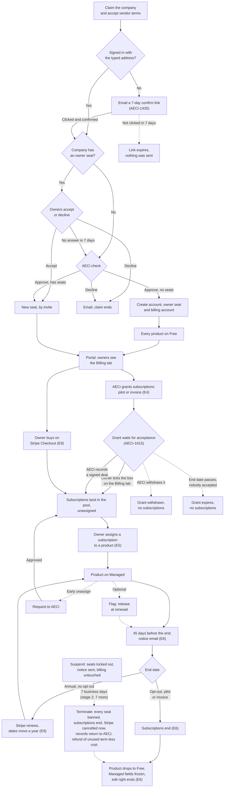

# Vendor signup, subscriptions and billing: the process

**Status: agreed in discussion with Chris on 2026-10-14. Mostly not yet built. Epics filed in Linear the same day (AECI-1331 to AECI-1340, project Pilot); parked items are AECI-1341 to AECI-1344.**

**Built so far (2026-10-20).** E1.1 to E1.9 (AECI-1350 to AECI-1358). E1.1 to E1.5 built the `billing_accounts` and `licenses` tables, the billing account at claim approval and seat provision, `lib/license.ts`, the dual-write from the entitlement builders, and `ops:backfill-licenses`. E1.6 (AECI-1355) made subscriptions the truth for plan resolution: a product is Managed exactly when it holds a live subscription, the vendor guard loads `licensedProductIds` and `licenses` into the session, writes on one product gate through `requireProductCapability`, `GET /api/vendor/me` carries a per-product `plan`, and the contest owner check, the vendor-updates `entitlement` cursor and the vendor snapshot read subscriptions. `license_mirror_drift` is now `error`. E1.7 (AECI-1356) moved the 11:00 expiry sweep onto subscriptions: one notice per billing account per term, audited as `license.expiry_warned`. E4.6 (AECI-1375, 2026-10-17) retired the admin entitlement and plan-pricing routes and their screens, so nothing writes `vendor_entitlements` or `vendor_plan_pricing` any more. E1.8 (AECI-1357) is done. PR 1 landed the same day: no reader of `vendor_plan_pricing` is left, `lib/vendor-plan-pricing.ts` is deleted, and every vendor sees "Managed is $25 a month or $250 a year per product." PR 2 dropped the table with migration 0081 (2026-10-17), after PR 1 reached prod (`docs/migrations.md` §3.2). E1.9 (AECI-1358) is done. PR 1 landed the same day: nothing reads or writes `vendor_entitlements`. `lib/vendor-entitlement.ts`, `ops:backfill-entitlements` and `ops:backfill-licenses` are deleted, the claim approval's `tier` reads the vendor's subscriptions, the admin user detail counts `licenses_granted`, erasure and the vendor delete no longer touch the table, and the seeds no longer insert it. PR 2 dropped the table with migration 0082 (2026-10-17), after PR 1 reached prod (`docs/migrations.md` §3.2). E1 is complete. Schema: `DATABASE_SCHEMA.md` §8.6b and §8.6c. E2.1 and E2.2 (AECI-1359, AECI-1360): the vendor terms at `/legal/vendor-terms` and the Managed plan agreement at `/legal/managed-plan-agreement`, drafts awaiting counsel's sign-off (both bumped to 1.1 on 2026-10-28 by AECI-1428: when Managed ends, the fields stay the vendor's; 1.0 archived. The vendor terms went to 1.2 on 2026-11-07 for counsel's held items, because production held a 1.1 acceptance; 1.1 archived). E2.3 (AECI-1361): every legal document has per-version URLs (`/legal/<slug>/v<version>`), a current pointer, and an on-page `## Change history` (`STAGE_1_SPEC.md` §27.3). E2.4 (AECI-1362): the `agreement_acceptances` table (§8.6d), its write helper `lib/agreement-acceptances.ts`, and two reads, `GET /api/vendor/billing/acceptances` (owner seats) and `GET /api/admin/vendors/:id/acceptances`. E3.3 (AECI-1366) is the first writer; E9 is the second. E3.1 to E3.5 (AECI-1364 to AECI-1368), the claim: a claim is on the company and records the product page it came from in `vendor_requests.context_product_id` (E3.1); the dialog has three steps with no plan question, and detail pages say "Claim <Company>" (E3.2); a required vendor terms box on every claim form, the acceptance written in the claim's batch (also for a typed-in listing request, migration 0078), and the claimant's `claim-received` receipt, one per address per day (E3.3); every approval lands on Free with an owner seat, links the claim's acceptances to the seat, vendor and billing account, and flags a pure connector vendor (E3.4); a claim on a company with an owner seat goes to its owners first, with AECi stepping in after 7 days (E3.5). E2.6 (AECI-588): the listing submission policy, public at `/docs/trust/listing-submissions` (what we list, suggesting versus claiming), with the operator side in `docs/LISTING_SUBMISSIONS_RUNBOOK.md` (owner and SLA, the listing checks, proof of domain control for a claim, reply templates). Counsel answered that the privacy policy must disclose that acceptance evidence survives erasure, and it does under "Retention" (AECI-1363, `AUTH_AND_RLS.md` §8). E3 (AECI-1333) is built end to end as of 2026-10-15: E3.1 to E3.5 are code, and E3.6 (AECI-1369) put a dated as-built note under every spec section they touch. E10 (AECI-1518 to AECI-1525, 2026-10-28) rewrote those sections; the help center was already current from E8 and E9.6. E4.1 to E4.5 (AECI-1370 to AECI-1374) are on `main` (PR #984): the admin subscription grant (E4.1), the read-only Billing tab (E4.3), subscription extend, re-reference and revoke (E4.2), early-unassign requests with the `license_release_requests` table and the admin queue (E4.4), and the cancel-at-term-end flags set by a ban and cleared by a new unbanned seat (E4.5, superseded 2026-11-03 by AECI-1589, and moved 2026-11-05 by AECI-1623: Terminate, after Suspend, now ends every subscription at once and the last-seat ban is refused). The same step, now Terminate, revokes the vendor's pending seat invites (ruled 2026-10-16), so a pre-ban invite cannot mint the unbanned seat that clears the flags; an unban restores no invite. The portal button for early unassign is E5.5 (AECI-1391, the Billing tab, `STAGE_2_VENDOR_PORTAL_SPEC.md` §6.21). E5.1 to E5.6 (AECI-1387 to AECI-1392) are on `main` (PR #990): the owner-only Billing tab (`/vendor/:slug/billing`) with subscriptions, source, dates and reference; assign a pool subscription to a product; the release-at-renewal flag; the early-unassign request dialog; the billing email (erasure nulls a matching address); the acceptance records; and no buy button (E9). `STAGE_2_VENDOR_PORTAL_SPEC.md` §6.21. E4.6 (AECI-1375, 2026-10-17) retired the set/renew/clear entitlement screen and `PATCH /api/admin/vendors/:id/entitlement`, and the price override screen and `PUT /api/admin/vendors/:id/plan-pricing` (decision 8). Subscriptions are the only admin write. A revoke that ends a vendor's last live subscription now carries the AECI-1092 contest re-route. `/admin/vendors` shows a sortable live subscription count in place of the entitlement and term columns. E6 (AECI-1336), on `main` since PR #1004: the lapse (AECI-1404) is a pre-step of the 11:00 expiry job that ends every passed term, `lapsed` or `released`, re-routes the vendor's open contests to AECi when the last subscription ends, purges, emails and writes audit rows. The carry-over (AECI-1405) moves a product on a lapsing subscription onto a spare pool subscription in the same batch. The renewal notice (AECI-1406, 45 days since AECI-1596) carries price, subscription count, products, a terms-change line and the billing email. The hand-back is the loss of the edit right only: nothing is written when a subscription ends. The portal (AECI-1408) counts whole UTC days: "ends today" shows on the end day only, and the new "overdue" panel state shows only on a later day, until the daily lapse job ends the subscription. It also adds a product-ended banner and sends owners to Billing from "Go to Billing". AECI-1409 synced the docs. E6b.1 to E6b.5 (AECI-1414 to AECI-1418, PRs #1007 to #1012, 2026-10-20) make ownership a stored fact that only the admin return undoes, have promote send nothing about an owned company except a new product as a frozen proposal, give owners the "Proposed products" tab, and tell the review app who owns what (end-to-end test waits on the review repo's AECI-1412; see the §5 E6b row). AECI-1381 (2026-10-23) lets AECi set or clear a vendor's billing email from the admin Billing tab (`PUT /api/admin/vendors/:id/billing/email`, the same audit-only write as the owner's). E7 is otherwise not built. See the §5 E6 row. E9 (Stripe, AECI-1499 to AECI-1504) is built as of 2026-10-28, with production checkout off until the switch-on. See the §5 E9 row.
This is the one place that describes how a vendor goes from "Claim this company" to products on
Managed and back to Free. Every other document, help page, email and screen must match this one.
The flow chart in §3a draws §3 as one picture.

Terms used:

- **Seat.** A person's access to a company's vendor account. Claiming gets you a seat.
- **Owner seat.** A seat that may buy subscriptions, assign them, invite colleagues and change the
  billing email. The first approved claimant is an owner. A vendor may have several owners.
- **Billing account.** Where money hangs: owner seats, billing email, Stripe customer, subscription
  pool. One per vendor today, created at claim approval. More than one later means teams.
- **Subscription.** One Managed slot. Assigned to one product. Comes from Stripe, an invoice, or is
  complimentary.
- **Free / Managed.** Free is what every seat can do at no cost. Managed is a product with a
  subscription assigned.

## 1. The deal

A vendor buys Managed subscriptions and assigns one to each product it wants on Managed. Pilot vendors
get complimentary subscriptions with an end date, no card. No plan changes where a product ranks,
whether it appears, or whether a review is published.

What a subscription costs, its monthly and annual terms, every discount, refunds and how a price changes
are in `docs/PRICING_RULES.md` (AECI-1431, 2026-10-29). This document describes the process and
does not restate those terms.

## 2. Decisions settled on 2026-10-14

| # | Decision |
|---|---|
| 1 | A claim is on the **company**, never a product. The form is titled "Claim <Company>". A product page pre-fills the company and names the product. |
| 2 | The claim form has no plan question. Every approved claim lands on Free. |
| 3 | The claim form has a required box: "I have read and accept the Vendor Terms on behalf of the company named above, and I am authorized to bind that company." We store who, when, version, IP. *Wording, plus the signer's title and the company's legal name, since AECI-1617 (counsel Q11).* |
| 4 | A claim on a company that already has seats goes to its owner seats to accept or decline. AECi steps in only if nobody answers in 7 days. |
| 5 | Managed is sold as **subscriptions** on a billing account, assigned to products. Several products can hold different plans under one bill and one term. |
| 6 | Subscriptions have a **source**: Stripe, invoice (PO or bespoke deal, recorded by AECi with an invoice reference and end date), or complimentary (pilot, end date, no card). |
| 7 | Prices: $250 a year, $25 a month. Monthly has **no commitment**. No volume tiers; a volume deal is an invoice-sourced grant. *Now stated in `PRICING_RULES.md` §2.* |
| 8 | Payment is **Stripe** (Checkout launched from our portal, Stripe Billing for renewals, card by default, Stripe invoice on request). The founding discount is a Stripe coupon. A pilot is a complimentary subscription, not a coupon. The per-vendor price override is retired. *Discounts: `PRICING_RULES.md` §3.* |
| 9 | The Managed plan agreement is accepted by the required box on the Stripe checkout page. A new version binds at the next renewal or purchase, announced in the 45-day email (30-day until AECI-1596). Nothing is re-signed mid-term. |
| 10 | Only owner seats buy. One Stripe customer per billing account; a second purchase changes quantity. |
| 11 | A subscription, once assigned, stays on its product until renewal. Unassigning early is a request to AECi, approved in the admin panel. A vendor may flag a product "release subscription at renewal" for a sunsetting product. |
| 12 | Fewer subscriptions than assigned products at renewal: the vendor chooses before the date, else oldest assignment keeps the subscription and we email. |
| 13 | Failed card: Stripe retries on its schedule and emails the vendor. Managed stays on through retries. When Stripe cancels, the product drops to Free. |
| 14 | When Managed ends, the vendor loses the edit right on the Managed fields. The text stays live and frozen as the vendor left it. Promote does not write it again; AECi edits it by hand in the admin panel if it must. The records stay vendor-owned (ADR 0042), so a new subscription gives the edit right back. Nothing reverts, and ending a plan deletes nothing. (revised 2026-10-19, AECI-1341) *As built 2026-11-05 (AECI-1618): for 30 UTC days after the end, an owner seat may remove the text the vendor wrote on that product (description, "How teams use it" and the two documentation links), as the Managed plan agreement says. Tags stay. It is the vendor's own choice, it cannot be undone, and a termination ends the option (`STAGE_2_5_SPEC.md` §12.2).* |
| 15 | A seat revoked changes nothing in billing. A vendor ends in two steps (ruling 1 of 2026-11-05, AECI-1623). **Suspend** locks every seat out of the portal at once, sends the written notice and leaves billing and the listing alone. **Terminate** is allowed once the applicable window has passed. It bans every seat, ends every subscription (`end_reason = 'banned'`), cancels its Stripe subscriptions at once with no proration, refunds the unused term less documented cost, returns the company's records to AECi, revokes pending seat invites and sends one `vendor-terminated` email with the itemized statement. The ban of a vendor's last unbanned seat is refused with `409 VENDOR_LAST_SEAT_USE_SUSPEND` and writes nothing. *As built 2026-11-05 (AECI-1623): the windows, the cost log and the refund are in the ruling of that date below. The D1 side is AECI-1589's one `db.batch` (2026-11-03), moved to `lib/vendor-termination.ts`. A `licenses` row keeps `ends_at` as the paid term end. A monthly Stripe row takes Stripe's `current_period_end`, read before the batch, or stays NULL when Stripe cannot be read. The cancel runs after commit (`DELETE /v1/subscriptions/:id`) on every subscription Stripe can still bill on the vendor's Stripe customer, live subscription or not, and the customer's open Checkout sessions are expired, within a 15 s deadline. The refunds follow the cancel, each under its own idempotency key. A cancel that fails leaves the Stripe subscription live in Stripe with no live subscription, and the next Stripe event or the daily reconcile cancels it, because every billable Stripe subscription of a vendor that is terminated and fully banned is ban-dead (`vendorBanDead`, `STAGE_2_PAID_TIERS_SPEC.md` §7.6 point 2). A seat revoke that leaves only banned seats is not ban-dead: that vendor got no notice and no refund, so its billing carries on. Non-payment is a separate path and is unchanged.* *Note 2026-10-28 (AECI-1516, ruling (a) below): when the revoke removes the last seat, or the company gives up its claim, an operator cancels its Stripe subscriptions at term end without the ban's marker, no refund (`RUNBOOKS.md` "Stripe: a company gives up its claim"). The revoke itself still writes nothing in billing.* |
| 16 | The billing account has a billing email separate from any seat, defaulted to the buyer's email at checkout. Receipts, failed-payment notices and renewal emails go there and to every seat. |
| 17 | The vendor portal gets a **Billing** tab: subscriptions, sources, assignments, Stripe link, term dates, acceptance records. The admin panel shows the same read-only, plus grant and approve actions. *Note 2026-10-23 (AECI-1381): the admin Billing tab also edits the billing email. Complimentary and invoice vendors never check out, so without it decision 16's emails reached seats only unless an owner acted. Same write and audit row as the owner's route, no email, no purge (`ADMIN_PANEL_SPEC.md` §2, the sixteenth exception).* |
| 18 | Build the billing-account table now with one row per vendor so teams (several billing accounts per vendor) need no data migration later. Show nothing for it in the UI yet. |

Ruled 2026-10-14: existing grants with no end date back-fill as open-ended complimentary subscriptions, Chris sets dates later (E1). "Ban a vendor" is the ban of the last unbanned seat; it flags every live subscription cancel-at-term-end (E4). *Superseded 2026-11-03 (AECI-1589): the ban now ends every subscription at once, see decision 15.* A claim on an already-seated company keeps the claim button; the form says the company's team will confirm them, with the 7-day fallback (E3). Connector-vendor claims are approved like any other; the alert and queue row carry a flag and Chris contacts them directly; the provision-connector-seat path is retired (E3, E4). Hand-back needs no new fence: promote's wholesale fence on a claimed vendor (`REVIEW_APP_PROMOTE_API.md` §4a) stays whole. *The narrow opening for the Managed-only fields on a product with no live subscription (E6, AECI-1407) was removed 2026-10-19 (AECI-1414, ruling on AECI-1341).* *Every other promote change to a claimed vendor becomes a proposal the owner accepts or declines* (withdrawn 2026-10-19, AECI-1341). Promote now sends nothing about an owned company. Only a new product arrives, as a proposal the owner accepts or declines (E6b). Attestations and search-engine resubmission are per product, like every other Managed right. A co-owned product is Managed only for the vendor whose billing account holds its subscription (E1, AECI-1355).

*As built 2026-10-19 (AECI-1405, E6.2), decision 12:* "oldest assignment keeps the subscription" is a carry-over at the end date. In the same batch that ends a term, each product on a lapsing subscription moves onto a live, unassigned subscription of the same billing account that does not end yet. The products assigned longest go first. A carried product keeps its original `assigned_at`, so it keeps its seniority at the next shortfall (ruling A, 2026-10-19). A product flagged "release subscription at renewal" never moves; its subscription ends `released`. Products left over drop to Free, and their "Managed has ended" email says the vendor had fewer subscriptions than products and that the products assigned longest kept theirs. "The vendor chooses before the date" is the release-at-renewal flag and the early-unassign request (decision 11). E9 reuses the same step at a Stripe renewal. `STAGE_2_PAID_TIERS_SPEC.md` §7.6 point 9.

Ruled 2026-10-19 (Chris, planning E6, AECI-1336): nothing is written at lapse, and revoke, release and lapse hand back the same way. *The promote-write parts of this ruling are withdrawn: the hand-back checked when promote writes, the AECi claims re-allowed on existing edges, and the usefulness rule below. Removed 2026-10-19 (AECI-1414, ruling on AECI-1341).* Fewer subscriptions than products means carry-over at lapse, oldest assignment first, and a product flagged release-at-renewal does not move (E9 reuses the step). "Go to Billing" goes to the Billing tab for owners. On the product-ended banner a member sees no button. On the vendor-wide banner a member keeps "Talk to us about Managed", which opens the contact page. A lapse re-routes open contests to AECi exactly like a revoke when it ends the vendor's last live subscription. The vendor-wide "Your Managed plan has ended" banner sends owners to Billing too, and when it shows the per-product banner is hidden, so a vendor never sees two.

Ruled 2026-10-19 (Chris, AECI-1420): one vendor per account stays (`STAGE_2_SPEC.md` §8.3). A group that controls several vendors uses one address per vendor. A claim from an address that already holds a seat on another vendor, or a staff account, is rejected at once, at submit, by the system. The claimant gets a `claim-rejected` email that names the vendor the address already manages and says to claim from a different work address. It goes to the address that holds the seat, so it hides nothing. This replaces the earlier idea of a neutral email after a delay. The on-screen receipt stays generic, because the person at the keyboard may not own the address. AECi sees a red flag on the claim, which matters when the check could not run at submit. An owner's Accept checks again and rejects the claim the same way. Multi-vendor accounts are parked. `STAGE_2_VENDOR_PORTAL_SPEC.md` §9 and §11a.10.

*As built 2026-10-21 (AECI-1435, ADR 0043):* "at submit" now means when the claim is sent, which for an anonymous visitor is the click on the emailed link, not the form submit. Ruled 2026-10-21 (Chris): the check runs at confirm. A claim waits in `request_confirmations` until the typed address clicks a 7-day, single-use link, and nothing above runs before that. A signed-in visitor whose verified email is the typed address sends the claim at submit, as before. The terms acceptance is written at confirm, with the submit's version, IP and user agent and the confirm time.

Stripe rulings (Chris, on AECI-1339 and its sub-issues):

- **Stripe Tax is on (ruled 2026-10-20).** This overturns the parking of sales tax below. Prices are
  tax-exclusive. Checkout calculates tax and collects a tax ID. Florida is registered (AECI-1497
  confirms the certificate). Revenue recognition of the annual price stays parked.
- **No interval mixing (ruled 2026-10-27).** One billing account holds one Stripe subscription, so
  one interval. A second checkout is refused with `409 STRIPE_SUBSCRIPTION_EXISTS`. New subscriptions
  are a quantity change on that Stripe subscription, at its interval (decision 10). An open, unpaid
  Checkout page could still pay for a second Stripe subscription, so checkout keeps at most one open
  page per customer: it reuses one for the same purchase and expires the rest
  (`API_CONTRACTS.md` §6.14, Checkout step 4).
- **The card statement reads THE WBS PROJECT (ruled 2026-10-27, settled 2026-10-28).** The account
  descriptor stays. A suffix `AEC INTEGRAT` was ruled on 2026-10-27. The build found that
  subscription-mode Checkout accepts no statement descriptor suffix, and the 2026-10-28 ruling R3
  accepts the fallback. Copy states THE WBS PROJECT and never a suffixed form.
- **Staging webhooks are unreachable by design (ruled 2026-10-27).** Cloudflare Access gates staging
  and Stripe cannot pass it (`access.md`). Staging purchases land through the daily reconcile.

Ruled 2026-10-28 (Chris, the E9 plan check):

- **R1, a superseded agreement version.** The webhook records the acceptance with the version the
  Checkout session showed, even when a newer one is current, provided it is a known version of that
  document (`LEGAL_AGREEMENT_KNOWN_VERSIONS`). A webhook never fails permanently on this. A renewal
  binds the current version (decision 9). So every agreement bump appends the old version to
  `LEGAL_AGREEMENT_KNOWN_VERSIONS`.
- **R2, production gating.** The per-env var `STRIPE_CHECKOUT_ENABLED` is `"false"` on production
  until the switch-on, and on demo while demo mirrors production (2026-10-31). It is `"true"` on
  local and staging. When it is off, or `STRIPE_SECRET_KEY` is unset, the
  checkout, add and portal routes answer `503 STRIPE_UNAVAILABLE` and the Billing tab hides the
  panel. The webhook does not read the flag. Stripe secrets are recommended, never required, on
  every tier.
- **R3, the descriptor.** As above.
- **R4, emails.** The purchase email reuses `licenses-granted` with source `stripe`. A monthly
  Stripe subscription has no end date, so it says the subscriptions renew monthly. `payment-failed` is new: to
  the billing email and every seat, once per invoice.
- **The ban cancel (the E9.2 open question).** A last-seat ban sets cancel-at-period-end on the
  vendor's Stripe subscription and marks it. An unban, a new unbanned seat or the reconcile clears
  a marked cancel. A cancel without the mark is the vendor's own and is never cleared
  (`STAGE_2_PAID_TIERS_SPEC.md` §7.6 point 2). *Superseded 2026-11-03 by the AECI-1589 ruling below.
  The ban cancels at once and the `aeci_ban_cancel` marker is gone.*

Ruled 2026-10-28 (Chris, legal week 0, AECI-1516): (a) when a company gives up its claim or loses every seat, its subscriptions run to the end of the paid term, do not renew, and are not refunded; the products move to Free when they end (Managed plan agreement v1.1, "If you give up your claim"). (b) Annual opt-out must be possible from the Stripe customer portal, not only by email: the annual portal configuration gets cancel-at-period-end, and the help pages, the renewal email and the runbook follow. Rulings still needed: none (checked 2026-10-15, AECI-1369; Stripe rulings added 2026-10-28). The rulings the E1 to E4 planning raised were settled on 2026-10-14. The E6 rulings are the 2026-10-19 paragraph above. The E6b rulings (Q1 to Q7, A to C, D1 to D6) are comments on AECI-1341, AECI-1416 and AECI-1418, and ADR 0042 records them.

Ruled 2026-11-03 (Chris, the legal AI pass, AECI-1363):

- **A ban ends subscriptions at once (AECI-1589).** *Superseded 2026-11-05 by ruling 1 below, built by AECI-1623. A seat ban now ends nothing unless it follows a terminated suspension.* A ban ends every subscription and cancels the Stripe
  subscription at once, with no refund, superseding the period-end ban cancel above. The Managed
  fields on the vendor's products return to AECi (the ADR 0042 return path), so operators can
  correct anything that was changed. Non-payment stays separate: Stripe retries, and Managed ends
  at term end if Stripe cancels. An unban lifts the seat ban and re-stamps ownership only. It
  grants no subscription. The operator then grants complimentary subscriptions for the rest of the term the
  ban cut short, from the vendor's Billing section on the admin vendor page ("Grant complimentary
  subscriptions for the ban term", `POST /api/admin/vendors/:id/licenses/ban-term`). *Wording gap for
  counsel: the Managed plan agreement says a ban "revokes every seat". The build bans the seat
  (`profiles.banned_at`, reversible) and revokes none. The vendor's experience is the same.*
  *Closed 2026-11-05: Terminate bans every seat. See ruling 1 below.*

Ruled 2026-11-03 (Chris, planning AECI-1589):

1. **Full return.** The ban clears `vendors.owned_at` and runs the whole ADR 0042 return in its
   batch, although the banned seat remains. The unban re-stamps `owned_at`.
2. **The unban grant is an operator action**, prefilled on the admin vendor page. The unban itself
   lifts the seat ban and re-stamps ownership only.
3. **Monthly term end.** The ban reads Stripe before its batch. If Stripe is unreachable the ban
   still proceeds with the term end unknown, and the operator types a date at grant time.
4. **A new `vendor-banned` email**, one per address, to every seat including the banned ones and
   the billing email. No `managed-ended` is sent on a ban. *Replaced 2026-11-05 by `vendor-terminated`
   (AECI-1623), which carries the itemized statement.*
5. **The `aeci_ban_cancel` marker machinery is deleted now.** Production has no Stripe
   subscriptions because checkout is off. Only the unban's clear of legacy `vendor-banned` flags
   stays.
6. **Contests the ban moved to AECi stay with AECi** on unban. They go unstamped, as the admin
   return does.
7. **`PATCH /api/admin/reviewers/:id` is rate-limited** (`rateLimit('write')`, after `requireAdmin()`).

Items 1, 3 and 4 above describe what Terminate does now, not what a seat ban does. The ban of a vendor's last unbanned seat is refused (ruling 1 of 2026-11-05).

- **Assignment to a buyer.** A company may transfer the Managed plan agreement and its subscriptions to
  a buyer of its business if it tells us first. Any other transfer stays barred.
- **Replies are ungated (AECI-1590).** Any company that has claimed a product may reply to a review
  of it, on any plan. AECI-1590 built this on 2026-11-03, and the Review Guidelines draft says so.

Ruled 2026-11-05 (Chris, on counsel's answers, AECI-1363). The draft agreements now say this. The build follows through the issues named, and `apps/web/src/content/legal/README.md` lists what must ship before an effective date is set:

- **Suspend, then end (ruling 1, Q13, AECI-1623, built 2026-11-05).** Replaces the 2026-11-03 ban rulings above. We suspend every seat out of the portal at once, then write naming the rule and the evidence. The company has 7 business days to cure or rebut. On a false-claim finding that stage 1 did not resolve, it has a further 7 business days to prove identity and authority. Then the subscriptions end with a refund of the unused term, less documented cost. Cost is staff time at $150 an hour, logged by task at the time, plus costs paid to others, counted only where the breach caused them, with recoveries credited. It is never more than the refund due, and an itemized statement goes with the refund. Ending a subscription ends the edit right and lets us correct or remove the vendor-maintained fields. The vendor keeps ownership of its text.
- **How the build follows ruling 1 (AECI-1623, as built 2026-11-05).** The last-seat ban on `PATCH /api/admin/reviewers/:id` answers `409 VENDOR_LAST_SEAT_USE_SUSPEND`, writes nothing and starts no suspension. Terminate bans every seat. A non-last seat ban stays one seat. Refund = paid x unused days / term days, minus cost, floored at zero. Cost is capped at the pre-cost refund. The period used ends on the suspension date, and a renewal charged inside the window is refunded in full before cost. The records return stays as built: `owned_at` is an operational lock, the vendor keeps ownership of its text, and `usefulness_source` and `logo_source` stay `vendor`. During suspension the vendor can cancel by replying to the notice or through the Stripe portal link, the one route a suspended seat may reach (`POST /api/vendor/billing/portal`). The Billing tab stays blocked. Stripe Tax adjusts tax liability on a plain refund by itself (https://docs.stripe.com/tax/invoicing/refunds), so no credit note is made. Details: `ADMIN_PANEL_SPEC.md` §5.7 and `RUNBOOKS.md` "Vendor suspension and termination".
- **Windows and cost log (counsel's Q13 follow-up, 2026-11-05, AECI-1623 and AECI-1363).** Each window is 7 business days. Business days are Monday to Friday with US federal holidays excluded, as observed. A window starts on the first confirmed send of that stage's notice, and a failed send leaves no clock. The stages are sequential. Stage 2 opens only on a false-claim finding that stage 1 did not resolve, with its own notice. Terminate is refused until the applicable stage has elapsed. There is no early path, because the window is also the vendor's chance to show we are wrong. The cost log is a server-stamped, append-only table (`vendor_abuse_cost_entries`) with `staff`, `third_party` and `recovery` lines. An entry is voided, never edited. Only costs the breach caused count. The deduction is never used to keep prepaid fees for the unused term. The statement goes out with the refund. Terminate reads the log, and an operator types nothing at Terminate except the amount paid on each invoice-paid subscription.
- **Legal pages match (updated 2026-11-07).** The Managed plan agreement says 7 business days in two stages (item 10.2). The Vendor Terms say the same since 1.2 (item 10.3, AECI-1363). The bump was needed because production holds a Vendor Terms 1.1 acceptance (`LEGAL_IMPACT_REVIEW.md` §2).
- **Indemnity cap (ruling 2, Q6).** The vendor's ordinary indemnity is capped at the greater of $10,000 or ten times the fees paid in the trailing twelve months. Fraud and intentional misrepresentation, willful misconduct and gross negligence, infringement by submitted content, breach of confidentiality and violation of law stay uncapped. The indemnity excludes loss from our own content or negligence, and stays one-way. Our own cap now has a $100 floor and named carve-outs.
- **Renewal refund (ruling 7, Q2).** The 14-day full refund applies after a renewal charge too. The section carries the applicable-law savings clause and the reversal of an erroneous or unauthorized charge.
- **Removal election (ruling 8, Q4, AECI-1618).** For 30 days after Managed ends, an owner seat may ask us to blank the text the vendor wrote in those fields. Catalog data and reviews are untouched.
- **45-day notice (Q7, AECI-1596).** Both agreements now match the code: the annual and grant-end notice goes out 45 days ahead. Monthly change notices stay at 30 days.

Parked for a later discussion, each with a Linear issue (AECI-1342 to AECI-1344, in order):

- Teams within a vendor: several billing accounts, each owning products.
- Connector vendors and subscriptions.
- Sales tax, and whether $250 up front is recognised over twelve months (accountant). *Sales tax
  collection is settled: Stripe Tax is on (ruled 2026-10-20, above). Revenue recognition stays parked.*

## 3. The process

1. **Claim.** Vendor clicks "Claim <Company>" on a company or product page. Form: name, title (it replaced role, AECI-1649),
   company legal name, work email, LinkedIn (optional), note (optional), the terms box. On send: on-screen receipt,
   email receipt, alert to AECi. Record: claim request plus terms acceptance.
   *As built 2026-10-21 (AECI-1435):* unless the vendor is signed in with the typed address, the
   send only emails a confirm link and the screen says "Check your inbox". The vendor clicks the
   link and presses "Confirm and send" on `/claims/confirm`. Only then do the record, the alert and
   the email receipt happen. The link works for 7 days.
2. **Check.** First the system checks the address (AECI-1420, 2026-10-19). An address that
   already holds a seat on another company, or a staff account, is declined when the claim is
   sent (at confirm since AECI-1435) with an email that says why. The confirm page says why too
   (ruled 2026-10-21): the click proved the mailbox. The signed-in screen stays generic. When the check cannot run, AECi's queue flags the claim and an owner's
   Accept checks again. Then AECi checks domain, LinkedIn, existing seats, competing claims.
   Decline sends an email and ends. Approve: if the company has no seats, create the account, the owner seat and
   the billing account; every product is Free. If it has seats, the owners accept or decline the
   new seat. Approval email carries the sign-in link, what Free includes and how Managed works.
3. **Portal.** Sign in by one-time link. Dashboard shows company details and the product list;
   each product carries its plan badge. Free edits work at once. Owners see the Billing tab.
4. **Buy subscriptions.** An owner opens Billing, picks a quantity and annual or monthly, and is sent
   to Stripe Checkout with the billing account carried along. The checkout requires the Managed
   agreement box. Stripe charges and emails a receipt. Our webhook sets the subscription count and
   term dates on the billing account. Email: "You have N Managed subscriptions until <date>."
   *As built 2026-10-28 (AECI-1500):* `POST /api/webhooks/stripe` records the agreement acceptance
   and runs one sync over the Stripe subscription (`lib/stripe-licenses.ts`). A monthly Stripe subscription has
   no end date, so its email says the subscriptions renew monthly. The checkout's `metadata` carries the
   billing account, the vendor, the owner's profile and the agreement version shown. If the
   `checkout.session.completed` event never arrives, the daily reconcile (AECI-1503) grants the
   subscriptions and backfills the missing acceptance.
5. **Pilot or invoice deal.** AECi grants N subscriptions with source complimentary or invoice, an end
   date and a reference, in the admin panel. Same email, with the free or invoiced wording. A
   vendor whose every owner seat is banned is refused until a seat is unbanned (AECI-1589,
   ruled 2026-11-03). A vendor with no seat yet can still be granted.
   *As built 2026-11-10 (AECI-1615, counsel Q5, rulings R1 to R6):* a grant no longer makes
   subscriptions live. It writes one `license_grants` row, `pending_acceptance`, that pins the
   Managed plan agreement version current that day (`DATABASE_SCHEMA.md` §8.6h). No subscription
   exists until the grant activates, in one of two ways:
   - **An owner accepts in the portal.** The Billing tab shows "Subscriptions waiting for you". The
     owner types a title, ticks the unticked box "I have read and accept the Managed plan agreement."
     and clicks Accept (`POST /api/vendor/license-grants/:id/accept`). One batch writes the
     acceptance row (source `grant`, method `portal_checkbox`, with IP, user agent and the text hash),
     the subscriptions in the pool, the grant's status and the audit rows. A member seat sees no
     grant.
   - **AECi records a signed deal (R5).** The grant form's "Recorded signed deal" section takes the
     signer, role, company legal name, signer email, deal reference, the version and date the deal
     names, the signed date and "signing accepts". The named version must be the current one. The
     grant activates in the create batch, with method `signed_deal`, and the owner sees no prompt.
   The owner seats get `license-grant-pending` at the grant and one reminder 7 days later (R4). The
   email above (`licenses-granted`) now goes at activation. A grant nobody accepts expires at its end
   date (the 11:00 sweep). AECi may withdraw a pending grant with a reason. The ban-term grant
   (AECI-1589) waits the same way (R1). If one of its products took a subscription while it waited,
   that subscription lands unassigned in the pool, with a warning (R6). The same holds for a product
   that left the vendor while it waited. An item whose own end date
   has passed is skipped. The acceptance names no product (R2). Grants live before AECI-1615 stay
   live with no acceptance (R3).
6. **Assign.** In Billing the owner assigns each subscription to a product. The product becomes Managed
   at once: Managed fields unlock and the public page updates. Products with no subscription stay Free.
   Mixed plans under one bill follow from this. *As built 2026-10-28 (AECI-1512):* a week
   after a grant, if a subscription from it is still on no product and the vendor owns a product on
   Free, the owner seats get `license-unassigned-reminder` once (`STAGE_2_PAID_TIERS_SPEC.md` §7.7).
7. **Add later.** Buying more is a quantity change. Stripe pro-rates the current period. New
   subscriptions land in the pool unassigned.
   *As built 2026-10-28 (AECI-1501):* "Add subscriptions" raises the Stripe subscription's quantity with
   `proration_behavior=always_invoice`, so Stripe charges the pro-rated amount at once, and
   `payment_behavior=pending_if_incomplete`, so the quantity rises only if that charge is
   paid. The subscriptions land when `invoice.paid` arrives, not on the request. The interval cannot change.
   When the charge is not paid (a declined card, an unfinished 3-D Secure check), the route
   answers `409 STRIPE_PAYMENT_INCOMPLETE` and the dialog says the card was not charged.
8. **Forty-five days before the end date** (annual, invoice and complimentary only): automatic email to
   every seat and the billing email with the date, the price, the subscription count, any terms change,
   and how to opt out or reduce. An owner opts out of a card renewal in the Stripe portal, or asks
   AECi. Reductions and early unassignments are requests to AECi.
   *Moved from 30 to 45 days by AECI-1596 (counsel, 2026-11-04):* 30 leaves no margin for a delivery
   or counting dispute. When card subscriptions renew, the email also states the charge. A card term the
   vendor already cancelled reads as ending, with no further charge.
9. **End date.** Annual with no opt-out: Stripe renews, dates move a year. Opt-out: an owner
   cancels in the Stripe portal before the date, or AECi cancels on request. Subscriptions end on
   it. Complimentary or invoice: subscriptions end unless replaced by a purchase. Monthly: runs until cancelled from the Stripe portal or by email.
   *As built 2026-10-28 (AECI-1500, AECI-1503):* a renewal is `invoice.paid` with billing reason
   `subscription_cycle`. It moves `ends_at` to the new period end and binds the current agreement
   version. The reconcile does the same if that event is missed. An opt-out is a cancel at period
   end, by the owner in the portal or by an operator on request (`RUNBOOKS.md` "Stripe: annual
   opt-out"). The flag shows as `cancel_at_term_end` with reason `vendor-cancelled`, and the
   subscriptions end when Stripe deletes the Stripe subscription. Both portal configurations cancel at period end only, with no proration.
   Both have quantity update and plan switching off. *Amended 2026-10-28 (AECI-1516):* the annual
   configuration had cancel off until then, so an annual opt-out was by email only. A company that
   gives up its claim or loses every seat gets the same cancel at period end from an operator,
   without the ban's marker (`RUNBOOKS.md` "Stripe: a company gives up its claim").
   *Added 2026-11-04 (AECI-1596):* every cancel at period end, monthly or annual, by the portal or by
   an operator after an email, sends `renewal-cancelled`: the end date, and that no further charge
   will be made. The sync that first sets the flag sends it, whether the webhook or the reconcile ran it.
10. **Subscriptions end.** Each affected product drops to Free automatically. Managed fields stay live
    as the vendor left them, and the vendor loses the edit right (decision 14, revised
    2026-10-19). A new subscription gives it back. Banner on the product with the end date and a
    "Go to Billing" button. Nothing entered is removed. Email: "Managed has ended for <products>."
    *As built 2026-11-10 (AECI-1515):* the email sends owners to Billing too. Its button is
    "Open Billing", and it says an owner can assign a subscription there or buy one. A reply
    still reaches AECi, for a seat that is not an owner or the billing email.
11. **Side paths.** Refund within 14 days on request, of a first or a renewal charge. Abuse or misrepresentation lets AECi suspend the
    vendor, then terminate it after the window: Terminate bans every seat, ends every subscription, cancels the Stripe
    subscription at once and refunds the unused term less documented cost (decision 15, ruling 1 of 2026-11-05, AECI-1623), or revoke seats. A chargeback drops the products to Free until settled.
    *As built 2026-10-28:* a refund is a Stripe refund plus a cancel of the subscription in Stripe,
    and the webhook ends the subscriptions (`RUNBOOKS.md` "Stripe: refund a paid subscription"). Revoking a
    paid subscription (by card) in the admin panel does not work: the next sync grants it back. No dispute
    event is handled, so a chargeback is not automated. An operator who wants the products on Free
    cancels the Stripe subscription, which ends the subscriptions for good rather than until settled.

## 3a. Flow chart

§3 steps 1 to 11 and the §2 decisions as one picture (AECI-1392, 2026-10-16). Dashed boxes are not
built yet. A label in parentheses names the epic that builds that step. Dotted arrows are optional
or side paths. If the chart and §3 disagree, §3 wins and the chart is redrawn.

## 4. The two agreements

- **Vendor terms** (at claim): who "you" means (claimant and company, authority to bind), who may
  claim, truthfulness, content rights and licence to publish (incl. name and logo permission, no
  confidential content), AECi may edit or remove content, no vendor-arranged reviews, claimed is
  not endorsed, plans never affect ranking or reviews, hand-back, seats and revocation, ending a
  claim, personal data, liability, indemnity, governing law, how changes bind (30-day email),
  general terms (precedence, notices, assignment, severability).
- **Managed plan agreement** (at checkout): what a subscription is and does, prices and the two
  billing options, annual renewal and 45-day notice, monthly cancel-any-time, 14-day refund on first and renewal charges,
  subscriptions stay assigned until renewal, hand-back on lapse, suspension for abuse or non-payment,
  liability cap at the greater of twelve months of fees or $100 (with named carve-outs), changes bind at the next
  renewal (monthly: 30-day email), plus who accepts and authority, card authorization, price
  changes never mid-term, tax line, refund mechanics, no promise of results, term and survival,
  general terms (precedence incl. a grant's own written deal, notices, assignment, severability). A grant
  starts when an owner seat accepts in the portal, or when a person with authority signs a deal that
  names the agreement by version and date and says signing accepts it (item 10.1). Disputes go only
  to the named Florida courts, with a bold jury waiver (items 11.13 and 11.17). The Vendor Terms carry the same since 1.2.

Both live at versioned URLs under `/legal/`: `/legal/vendor-terms` and `/legal/managed-plan-agreement`,
with each superseded version at `/legal/<slug>/v<version>` (`STAGE_1_SPEC.md` §27.3). The acceptance
store is `agreement_acceptances` (`DATABASE_SCHEMA.md` §8.6d). Store for each acceptance: who (the claimant's email and
request at claim time, the seat once one exists), time, version, billing account, source (claim,
checkout or grant), and the Stripe session id for the plan agreement. IP and user agent are recorded
on the claim path and on a portal grant accept. The checkout acceptance is written from the Stripe
webhook and has neither. A signed-deal acceptance has neither, because the admin's browser records
it. The Privacy Policy keeps email, time and version for the life of the vendor account plus six years, and promises the IP and user agent are deleted 90 days after acceptance (ruling 11). *As built 2026-11-10 (AECI-1636):* the daily `acceptance-evidence-removal` job at 17:00 UTC nulls `ip` and `user_agent` on every acceptance more than 90 days old, claim and portal grant rows alike, and stamps `evidence_removed_at`. Email, time and version stay. Each batch writes one `agreement.evidence_removed` audit row. The owner's Billing tab never showed either field. The admin Billing tab reads "Removed after 90 days" in the IP column (`DATABASE_SCHEMA.md` §8.6d). A one-hour lawyer read before the first
paid subscription is recommended. This document is not legal advice.

*As built, AECI-1366 (2026-10-15).* The box linked `/legal/vendor-terms` (AECI-1617 below changed its words). It is required on every claim form, including a typed-in
listing request, whose acceptance names the `listing_requests` row (`listing_request_id`, migration
0078) because there is no claim. The server stamps the version, IP and user agent. The email receipt
in step 1 is `claim-received`, at most one per address per day, with no link that grants anything
(`VENDOR_PROGRAM_PAGE_SPEC.md` §15.3).

*As built, AECI-1435 (2026-10-21).* For an anonymous claim the acceptance row is written when the
emailed link is confirmed, not at submit. It carries the version shown, the IP and the user agent of
the submit, kept on the pending `request_confirmations` row, and the confirm time. A terms bump in
the 7 days between makes the link fail, and the visitor starts again.

*As built 2026-10-28 (AECI-1501, AECI-1503).* The Checkout box text is the agreement's own quoted
wording, "I have read and accept the Managed plan agreement.", and it links the unversioned
`/legal/managed-plan-agreement` page. No versioned URL is needed, because the acceptance row records
the version shown (the checkout's `terms_version` metadata, ruling R1). The webhook writes that row.
If the webhook missed it, the daily reconcile writes the same row through the same builder.

*As built 2026-11-05 (AECI-1617, counsel Q11 and Q15).* The claim box reads "I have read and accept the Vendor Terms on behalf of the company named above, and I am authorized to bind that company." It starts unticked, and submit stays disabled until it is ticked, including Continue on the dialog's You step.

- **Signer.** The form requires "Title" and "Company legal name". The legal name is pre-filled from a found listing's company, is editable, and starts blank on a typed-in listing. Both are stored on the claim or listing request. The acceptance row copies them with the claimant's name (`signer_name`, `signer_title`, `company_legal_name`). The columns stay out of the audit row.
- **Signer at checkout (ruled 2026-11-05).** The Stripe page has no form, so the checkout route reads the signer before the session opens (`loadCheckoutSigner`) and writes `signer_name`, `signer_title` and `company_legal_name` into the session's metadata only, not the subscription's. The webhook and the reconcile copy them onto the acceptance row. The name is the profile's display name, else the seat's claim. The Managed plan agreement says we record these where we hold them, and the Privacy Policy says we pass them to Stripe with the checkout (items 10.7 and 10.8).
  *As built 2026-11-06 (AECI-1625).* The legal name now has a home, `vendors.legal_name`. The checkout takes it from there, else from the newest claim acceptance that recorded one. It never reads `billing_accounts.name` or `company_name`, because neither is a legal name. The title is what the buyer typed in the required "Your title" field on the buy form (`signer_title`, 1 to 100 characters), else this seat's own newest claim title. The form pre-fills the field from `checkout_signer_title` on `GET /api/vendor/billing`. An invited seat has no claim, so it types the title. A reused open Checkout Session must match the signer metadata too, or it is expired. The Checkout idempotency key gains a 12-hex signer digest.
- **The legal name field (AECI-1625, 2026-11-06).** Claim approval fills `vendors.legal_name` from the claim's company legal name only while the column is empty. Chris ruled this on AECI-1625, because a later claimant must not undo an owner's or an admin's correction. An owner seat edits it under Billing, beside "Billing email", and an admin edits it on the vendor's Billing tab. Each change writes a `vendor.legal_name_changed` audit row. Promote never writes it.
- **Where it shows.** Both acceptance tables have a "Signer" column: the admin Billing tab and the owner's Billing tab.
- **Short form beside the claim box.** "Our total liability to you under the Vendor Terms is limited to $100, with the exceptions stated there. The Vendor Terms also exclude lost profits, lost business, and indirect or consequential loss." It then points to "Disclaimers and liability". Since Vendor Terms 1.2 (item 10.6, 2026-11-07) the Vendor Terms hold both the cap and the exclusion, so both sentences credit them.
- **Short form at checkout.** `custom_text.submit` and the Pay by card panel add the agreement's cap and exclusion after AECI-1596's renewal terms, which already state the fees. The cap sentence follows the per-product base of item 11.19 (ruled 2026-11-07): "Our liability under the agreement is limited to the greater of the fees you paid for this product's subscription in the twelve months before a claim, or $100, with the exceptions stated there." The terms box stays one sentence.
- **Copy guard.** `legal-page.component.spec.ts` holds the documents to the terms these short forms restate. Legal pages have no heading ids, so the short forms name the section and link the page.
- **Links from before the deploy.** A pending anonymous request with neither field still confirms, with NULLs (`StoredClaimRequestSchema`, `StoredListingRequestSchema`).

*As built 2026-11-10 (AECI-1615, counsel Q5).* A grant acceptance is a third kind of row, source `grant` (`DATABASE_SCHEMA.md` §8.6d).

- **Method.** `portal_checkbox` for an owner's accept on the Billing tab, `signed_deal` for a deal AECi records. Claim and checkout rows leave it NULL.
- **Version.** The accept must name the version the grant pinned at create, current or not, so the grant-date version governs the whole term. A stale page gets `409 LICENSE_GRANT_VERSION_CHANGED`.
- **Text hash.** `text_sha256` is the SHA-256 of that version's Markdown, from `LEGAL_AGREEMENT_TEXT_SHA256`. The API Worker cannot read the Markdown, so the constant carries it. `agreement-text-hash.spec.ts` recomputes every value from the files and fails on drift.
- **Other fields.** `license_grant_id`, `grant_ends_at` and `seat_role` (`owner`, or NULL on a signed deal). A signed deal adds `deal_reference` and `deal_signed_at`, with the signer's name, role and the company legal name in the signer columns. The signer on a portal accept is `loadCheckoutSigner`, as at checkout.
- **The checkbox shown (ruling 16, Chris 2026-11-10).** Every acceptance row stores `checkbox_label_sha256`, the SHA-256 of the exact box label, and `checkbox_default_unticked`. The labels are `AGREEMENT_CHECKBOX_LABELS` in `packages/shared`. A claim writes the vendor terms label, and checkout and the portal accept write the Managed plan sentence. All three write unticked = 1. A claim confirmed under an older vendor terms version writes NULL for both, because its submit may have shown an older label. A signed deal has no box and writes NULL for both (`DATABASE_SCHEMA.md` §8.6d).
- **Retention.** No prune deletes an acceptance or a grant (`NEVER_PRUNED` in `lib/retention-prune.ts`). A grant acceptance is kept at least five years from the day the grant's last subscription ends, by lapse, revoke, release or Terminate, whichever comes first. The scheduled `ends_at` alone does not set it. A grant never accepted is kept five years from its withdraw or expiry (counsel Q5(c)).
- **Where it shows.** Both acceptance tables label the row "Grant". The owner's tab adds "accepted in the portal" or "by signed deal". The admin tab has Method and Grant columns.

## 5. Epics

*Renewal and refund text changed 2026-11-05 (§2, AECI-1363): the notice is 45 days in both agreements, and the 14-day refund now covers a renewal charge. The Stripe build needs no change for either, since refunds are an operator action (`RUNBOOKS.md` "Stripe: refund a paid subscription").*

In build order. The numbers are the order. E1 to E8 are enough to seat pilot vendors on
complimentary subscriptions. E9 (Stripe) must land before the first pilot end date. Each is a
Linear epic. E1 to E4 have sub-issues filed 2026-10-14 (AECI-1350 to AECI-1375); each epic carries its plan and findings as a comment.

| # | Epic | What it delivers | Needed for | Depends on |
|---|---|---|---|---|
| E1 (AECI-1331) | **Billing accounts and subscriptions** (data model) | `billing_accounts` (billing email, Stripe customer id), `licenses` (source, start, end, reference, assigned product, release-at-renewal and cancel-at-term-end flags, terms version). The owner flag on seats already exists (`profiles.seat_owner`); invite-accepted seats stay non-owner. One billing account per vendor, created at claim approval and back-filled for existing vendors. Plan resolution reads "does this product hold a live subscription" instead of the vendor-wide row. The old entitlement row and the price override are retired. *As built: the override has no reader since AECI-1357 PR 1, and migration 0081 dropped its table (2026-10-17). The entitlement row has no reader or writer since AECI-1358 PR 1, and migration 0082 dropped its table (2026-10-17). E1.1 to E1.9 are done.* Audit rows for every change. | pilot | none |
| E2 (AECI-1332) | **Agreements** | Vendor terms page and Managed plan agreement page, versioned, with the acceptance store and the renewal-notice wording. Lawyer read. | pilot | none (E2.4 waits for E1.1) |
| E3 (AECI-1333) | **Claim is on the company** | Form retitled, product-page entry pre-fills the company, plan question removed, vendor-terms box with acceptance record, receipt email to the claimant, approval always Free, owner seat on first approval, "company already has seats" routed to its owners with a 7-day AECi fallback, approval email rewritten. | pilot | E1.2, E2.1, E2.3, E2.4 (E3.1, E3.2 start now) |
| E4 (AECI-1334) | **Admin: grants and approvals** | Grant complimentary or invoice subscriptions with end date and reference, approve early-unassign requests, read-only Billing view per vendor, cancel-at-term-end on ban. *Superseded 2026-11-03 (AECI-1589): a ban ends the subscriptions and cancels at once, and the operator grants the ban term back after an unban. Superseded again 2026-11-05 (AECI-1623): that happens at Terminate, after Suspend, with a refund.* Replaces the set/renew/clear entitlement screen. **E4.1 to E4.5 on `main` (PR #984). E4.6 (AECI-1375) retired the entitlement and price override screens and routes on 2026-10-17.** *AECI-1615 (2026-11-10, counsel Q5): a grant waits for an owner's in-portal accept or a recorded signed deal before any subscription exists, the ban-term grant included (§3 step 5). Migration `0115_swift_master_mold` adds `license_grants`.* | pilot | E1.1, E1.3, E1.6, E2.4 |
| E5 (AECI-1335) | **Vendor Billing tab, assignment** | Subscriptions with source and dates, assign and release-at-renewal, request early unassign, billing email, acceptance records. Owner-only. **E5.1 to E5.6 on `main` (PR #990, 2026-10-16). The buy button came with E9 (AECI-1502).** | pilot | E1.6, E4.4 |
| E6 (AECI-1336) | **Term end and hand-back** | Daily job: 30-day email with price, count and terms-change notice; automatic lapse on the end date; hand-back of Managed fields (the vendor loses the edit right, content stays); cache purge; fewer-subscriptions-than-products rule; "ends today" panel bug gone. *As built 2026-10-19 (AECI-1404 to AECI-1409, on `main` since PR #1004): the lapse is a pre-step of the 11:00 `entitlement_expiry` job, not a new cron (`STAGE_2_PAID_TIERS_SPEC.md` §7.6). Carry-over (AECI-1405) runs in each term's batch. The 30-day notice is rebuilt (AECI-1406). Hand-back is the loss of the edit right only (revised by E6b, AECI-1414). The portal gains the "overdue" state, the product-ended banner and the owner link to Billing (AECI-1408). No migration. The notice text and the lapse trigger are done, so E7 does not rebuild them. AECI-1596 moved the notice to 45 days (§3 step 8).* | pilot | E1.3, E1.7, E4.2 |
| E6b (AECI-1341) | **Record ownership and proposed products** | Promote never overwrites an owned company (ruled 2026-10-19): it sends nothing about the vendor or any product it holds. The only thing it may send is a new product, stored as a proposal the owner accepts or declines in the portal "Proposed products" tab, the accept applied in an audited batch with purge, the review app told in `skipped[]`. A proposal carries the product only (Q4), and a ref is sent once, ever (Q5). *As built 2026-10-20 (E6b.1 to E6b.5, AECI-1414 to AECI-1418; PRs #1007, #1008, #1009, #1010 and #1012, stacked, to merge in that order; ADR 0042). E6b.1 (#1007, AECI-1414): the AECI-1407 opening is gone, and promote writes nothing to a claimed vendor's product, with or without a live subscription. E6b.3 (#1008, AECI-1415, migration 0083): ownership is stored in `vendors.owned_at`, set at claim approval and at the admin seat provision. Seat loss never moves it, so a revoke, a ban or an erasure leaves the records vendor-owned and frozen, and only the admin "Return records to AECi" action (refused while any seat remains) hands them back. Promote refuses an owned vendor, every product joined to one, and every integration whose source or target product is owned. E6b.4 (#1009, AECI-1416, migration 0084): a new product under an owned vendor is stored in `product_proposals` (`DATABASE_SCHEMA.md` §8.6f) with a `product_proposal.created` audit row, addressed to the first owned vendor in payload order. The frozen payload is the whole product and every vendor it named, with resolved ids, so an accept creates exactly what was sent. Its taxonomy is unresolved, and its ref must be `p:rec…`. "Return records to AECi" discards the vendor's open proposals, and a promote that commits after a return aborts with `VENDOR_RETURNED_DURING_PROMOTE`. The skip carries `proposalId`. Integrations touching it are skipped, never stored. A re-send of the same ref is refused whatever the proposal's state, and a racing send errors with `PRODUCT_PROPOSED_DURING_PROMOTE` (`REVIEW_APP_PROMOTE_API.md` §4a). E6b.5 (#1010, AECI-1417): the owner-only "Proposed products" tab (`/vendor/:slug/proposals`, `STAGE_2_VENDOR_PORTAL_SPEC.md` §6.22) lists open proposals with every vendor and every taxonomy value, the ones that name no existing term marked. Accept creates the product exactly as proposed, with every vendor link, find-only taxonomy (missing terms dropped and listed, none minted), `maintained_by = 'vendor'`, in one audited batch with the decision, then purges what a promote create purges and syncs Algolia. It is refused when the proposal is decided, the vendor no longer owns its record or a linked vendor is gone. Decline records the decision only. Each owner seat gets one `product-proposal-owner-review` email per proposal, sent from promote's post-commit hooks. E6b.2 (#1012, AECI-1418, migration 0085): the review app is told who owns each vendor's records. After a claim approval, an ownership-stamping seat provision, a proposal accept or decline, and "Return records to AECi", the route enqueues one message on `aeci-ownership-sync-{env}`. The API Worker consumes it and `PUT`s the vendor's whole current ownership record (owner, products, the Q2 integrations from `integrations` and `connector_evidenced_pairs`, proposals with their decisions) to `REVIEW_APP_OWNERSHIP_URL` with `REVIEW_APP_OWNERSHIP_TOKEN` (`REVIEW_APP_PROMOTE_API.md` §4d, ADR 0042 amendment 2026-10-20). Each attempt writes an `ownership_sync_deliveries` row. A tier with no receiver configured acks as `unconfigured` and warns. `ops:backfill-ownership-sync` sends one per already-owned vendor (Q7); its prod run waits on AECI-1412 and Chris's go-ahead. The end-to-end test waits on AECI-1412. E6b.6 (AECI-1419) synced the docs and the vendor-facing hand-back copy. Not in E6b: vendor product create (AECI-1424, landed 2026-10-22 after the epic: an owner seat adds a product from the Products tab, `STAGE_2_VENDOR_PORTAL_SPEC.md` §4.8) and the mirror of vendor edits to the review app (AECI-1413, ADR 0044: ownership record v2 carries owned content, contract defined 2026-10-22 in AECI-1452, producer behind `REVIEW_APP_MIRROR_SCHEMA`). The review-app receiver (AECI-1412) is live on production; the backfill delivered 4 of 4 on 2026-10-22.* | pilot | E1.2, E6 |
| E7 (AECI-1337) | **Emails and notifications** | New: claim received, subscriptions on, subscriptions added, 30-day notice, payment failed (ours, alongside Stripe's), Managed ended, new product added to your company (Free). Rewritten: claim approved, expiry warning. Registry and `NOTIFICATIONS.md` regenerated. *As built 2026-10-19: the 30-day notice and the lapse's Managed ended email shipped in E6 (AECI-1406, AECI-1404). E7 does not rebuild them. AECI-1596 moved the notice to 45 days and added `renewal-cancelled`.* | pilot | E1 (templates for E3, E4 ship inside those epics) |
| E8 (AECI-1338) | **Public copy and help center** | Vendor program page, plans page, claiming page, your-seat page, new billing page, FAQ: subscriptions, both prices, no commitment on monthly, 14-day refund, hand-back on lapse. Remove "invoice or purchase order", "within 48 hours", the pilot mention, the plan-interest question, the Managed inquiry dialog. *The Billing help page's Stripe lines landed with E9.6 (AECI-1504, 2026-10-28). AECI-1396 (2026-10-28) flipped the rest: the vendor program FAQ, the plans comparison row, the claiming and dashboard pages, the Billing tab intro and the plan panel buttons.* | pilot | E1 to E7 |
| E9 (AECI-1339) | **Stripe** | Product and two prices in Stripe, the buy and add buttons on the Billing tab launching Checkout with the billing account carried along and the agreement box required, Customer Portal with cancel allowed on monthly only (amended 2026-10-28 by AECI-1516: both intervals cancel at period end), coupons for pilot or founding discounts, webhook in the API Worker for checkout completed, invoice paid, payment failed, Stripe subscription deleted, each writing subscriptions in an audited batch. *As built 2026-10-28 (ADR 0047). E9.1 (AECI-1499): per-tier secrets, recommended on every tier, and `lib/stripe.ts`, a thin fetch client with no SDK, pinned to one `Stripe-Version`. E9.3 (AECI-1501): `POST /api/vendor/billing/checkout`, `/licenses/add` and `/portal`, owner-only, behind `STRIPE_CHECKOUT_ENABLED`. Checkout turns on Stripe Tax, tax ID collection, promotion codes and the required terms box. E9.2 (AECI-1500): `POST /api/webhooks/stripe` verifies the signature, writes a `stripe_events` row first in each batch, re-reads the Stripe subscription and runs one sync that owns every paid subscription. It handles five events: the four above plus `customer.subscription.updated`. E9.4 (AECI-1502): the Pay by card panel, the Add subscriptions dialog, Manage billing in Stripe and the return banner. E9.5 (AECI-1503): the daily `stripe-reconcile` cron, the backstop for a missed webhook. E9.6 (AECI-1504): help, specs, ADR 0047 and runbooks. Production checkout stays off until the switch-on (`RUNBOOKS.md` "Turning on Stripe in production"). AECI-1589 (2026-11-03) and AECI-1623 (2026-11-05): Terminate cancels the Stripe subscription now and refunds the unused term, and the sync cancels any billable Stripe subscription of a terminated, fully banned vendor, or whose subscriptions a ban ended (outcome `ban-dead`, `ADR 0047` decision 5). AECI-1596 (2026-11-04, counsel's Q7): the baseline is the Restore Online Shoppers' Confidence Act, 15 U.S.C. 8403, which asks for the material terms before billing details are collected, informed consent and simple cancellation. The Pay by card panel states today's charge, the recurring charge, the renewal date, renewal until cancelled and both cancel routes before the redirect, and `custom_text.submit` repeats them on Stripe's page. The terms box keeps its one sentence. AECI-1617 (2026-11-05, counsel's Q15): the panel and `custom_text.submit` also state the agreement's cap and damages exclusion (§4). New Stripe customers carry `invoice_settings.footer`, so each invoice says it renews, when the next charge falls and how to cancel. ADR 0047 decision 8.* | first paid subscription | E1.1, E2.2, E2.4, E5 |
| E10 (AECI-1340) | **Spec and doc sync, retirements** | Rewrite Paid Tiers §5, §7, §8, §13; Vendor Portal claim approval and §6.18; Program Page spec §15; Stage 2.1 pilot dates; Data Readiness open questions; Database Schema; API Contracts; ADR 0037 superseded by a new ADR. Close or re-scope AECI-1114, 1157, 1294, 1313, 1324, 1325, 1326, 1327, 1328, 1290. Parking issues for proposed promotions, teams, connector vendors, sales tax. *As built 2026-10-28 (E10.1 to E10.8, AECI-1518 to AECI-1525): the listed spec sections now state this contract in their body, with section numbers unchanged. ADR 0048 supersedes ADR 0037. The ten retirement issues were already closed. The parking issues are AECI-1341 (built as E6b), AECI-1342, AECI-1343 and AECI-1344, which now covers revenue recognition only. Paid Tiers §1 to §4 still carry entitlement-era text (AECI-1526).* | alongside all | all |

*As built, E8 (AECI-1338, 2026-10-19).* The vendor program page, the Plans page, the new Billing page (`/docs/vendors/billing`) and the claiming, your-seat, dashboard and overview pages state §1 per product: subscriptions, $250 a year or $25 a month, monthly with no commitment, annual renewal, the 14-day refund and hand-back. No page offers to bill by invoice or purchase order, and none states a claim decision time, the pilot or a plan question. The Managed inquiry is gone: the dialog, `/contact?topic=managed`, `POST /api/plan-inquiries`, both emails and `plan_inquiry_submitted`. "Questions? Contact us" links to `/contact`. Lines that need E6 are on AECI-1395, and lines that need E9 are on AECI-1396. *AECI-1395 flipped the E6 lines on 2026-10-28. Its hand-back targets followed decision 14 as revised ("stay just as you left them"), not "we may update them". The vendor-wide banner kept its heading, lede and member link under the 2026-10-19 ruling.* *AECI-1504 (E9.6) wrote the E9 lines on 2026-10-28: the Billing page covers paying by card, adding subscriptions, the Stripe billing page, opt-out, the card statement, refunds and failed payments. AECI-1396 wrote the remaining rows the same day. The public FAQ and comparison name card payment while production checkout is still off (ruled 2026-10-28, Chris). In the plan panel an owner goes to Billing from the Free state ("Go to Billing") and the expiring state ("Manage renewal").* AECI-1397 (Platform) dropped the two unused `plan_interest` columns with migrations `0093` and `0094`. E8.6 (AECI-1403) dropped `plan_inquiries` with migration `0091` on 2026-10-27, after this reached prod.
