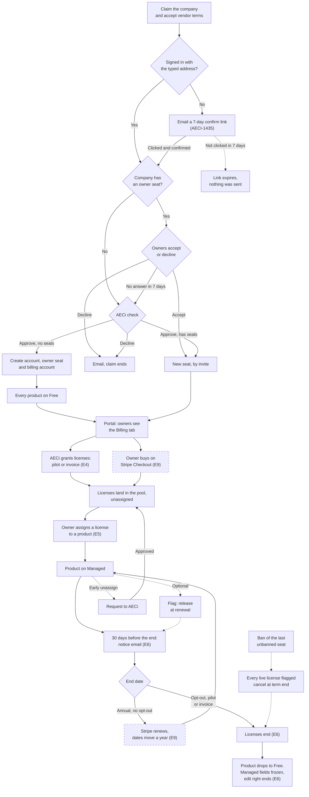

# Vendor signup, licenses and billing: the process

**Status: agreed in discussion with Chris on 2026-10-14. Mostly not yet built. Epics filed in Linear the same day (AECI-1331 to AECI-1340, project Pilot); parked items are AECI-1341 to AECI-1344.**

**Built so far (2026-10-20).** E1.1 to E1.9 (AECI-1350 to AECI-1358). E1.1 to E1.5 built the `billing_accounts` and `licenses` tables, the billing account at claim approval and seat provision, `lib/license.ts`, the dual-write from the entitlement builders, and `ops:backfill-licenses`. E1.6 (AECI-1355) made licenses the truth for plan resolution: a product is Managed exactly when it holds a live license, the vendor guard loads `licensedProductIds` and `licenses` into the session, writes on one product gate through `requireProductCapability`, `GET /api/vendor/me` carries a per-product `plan`, and the contest owner check, the vendor-updates `entitlement` cursor and the vendor snapshot read licenses. `license_mirror_drift` is now `error`. E1.7 (AECI-1356) moved the 11:00 expiry sweep onto licenses: one notice per billing account per term, audited as `license.expiry_warned`. E4.6 (AECI-1375, 2026-10-17) retired the admin entitlement and plan-pricing routes and their screens, so nothing writes `vendor_entitlements` or `vendor_plan_pricing` any more. E1.8 (AECI-1357) is done. PR 1 landed the same day: no reader of `vendor_plan_pricing` is left, `lib/vendor-plan-pricing.ts` is deleted, and every vendor sees "Managed is $25 a month or $250 a year per product." PR 2 dropped the table with migration 0081 (2026-10-17), after PR 1 reached prod (`docs/migrations.md` §3.2). E1.9 (AECI-1358) is done. PR 1 landed the same day: nothing reads or writes `vendor_entitlements`. `lib/vendor-entitlement.ts`, `ops:backfill-entitlements` and `ops:backfill-licenses` are deleted, the claim approval's `tier` reads the vendor's licenses, the admin user detail counts `licenses_granted`, erasure and the vendor delete no longer touch the table, and the seeds no longer insert it. PR 2 dropped the table with migration 0082 (2026-10-17), after PR 1 reached prod (`docs/migrations.md` §3.2). E1 is complete. Schema: `DATABASE_SCHEMA.md` §8.6b and §8.6c. E2.1 and E2.2 (AECI-1359, AECI-1360): the vendor terms at `/legal/vendor-terms` and the Managed plan agreement at `/legal/managed-plan-agreement`, both v1.0 drafts awaiting counsel. E2.3 (AECI-1361): every legal document has per-version URLs (`/legal/<slug>/v<version>`), a current pointer, and an on-page `## Change history` (`STAGE_1_SPEC.md` §27.3). E2.4 (AECI-1362): the `agreement_acceptances` table (§8.6d), its write helper `lib/agreement-acceptances.ts`, and two reads, `GET /api/vendor/billing/acceptances` (owner seats) and `GET /api/admin/vendors/:id/acceptances`. E3.3 (AECI-1366) is the first writer; E9 is the second. E3.1 to E3.5 (AECI-1364 to AECI-1368), the claim: a claim is on the company and records the product page it came from in `vendor_requests.context_product_id` (E3.1); the dialog has three steps with no plan question, and detail pages say "Claim <Company>" (E3.2); a required vendor terms box on every claim form, the acceptance written in the claim's batch (also for a typed-in listing request, migration 0078), and the claimant's `claim-received` receipt, one per address per day (E3.3); every approval lands on Free with an owner seat, links the claim's acceptances to the seat, vendor and billing account, and flags a pure connector vendor (E3.4); a claim on a company with an owner seat goes to its owners first, with AECi stepping in after 7 days (E3.5). E2.6 (AECI-588): the listing submission policy, public at `/docs/trust/listing-submissions` (what we list, suggesting versus claiming), with the operator side in `docs/LISTING_SUBMISSIONS_RUNBOOK.md` (owner and SLA, the listing checks, proof of domain control for a claim, reply templates). Whether the privacy policy must disclose that acceptance evidence survives erasure is open for counsel (AECI-1363, `AUTH_AND_RLS.md` §8). E3 (AECI-1333) is built end to end as of 2026-10-15: E3.1 to E3.5 are code, and E3.6 (AECI-1369) put a dated as-built note under every spec section they touch. E10 does the full rewrites of those sections and the help center. E4.1 to E4.5 (AECI-1370 to AECI-1374) are on `main` (PR #984): the admin license grant (E4.1), the read-only Billing tab (E4.3), license extend, re-reference and revoke (E4.2), early-unassign requests with the `license_release_requests` table and the admin queue (E4.4), and the cancel-at-term-end flags set by a ban and cleared by a new unbanned seat (E4.5). The same last-seat ban revokes the vendor's pending seat invites (ruled 2026-10-16), so a pre-ban invite cannot mint the unbanned seat that clears the flags; an unban restores no invite. The portal button for early unassign is E5.5 (AECI-1391, the Billing tab, `STAGE_2_VENDOR_PORTAL_SPEC.md` §6.21). E5.1 to E5.6 (AECI-1387 to AECI-1392) are on `main` (PR #990): the owner-only Billing tab (`/vendor/:slug/billing`) with licenses, source, dates and reference; assign a pool license to a product; the release-at-renewal flag; the early-unassign request dialog; the billing email (erasure nulls a matching address); the acceptance records; and no buy button (E9). `STAGE_2_VENDOR_PORTAL_SPEC.md` §6.21. E4.6 (AECI-1375, 2026-10-17) retired the set/renew/clear entitlement screen and `PATCH /api/admin/vendors/:id/entitlement`, and the price override screen and `PUT /api/admin/vendors/:id/plan-pricing` (decision 8). Licenses are the only admin write. A revoke that ends a vendor's last live license now carries the AECI-1092 contest re-route. `/admin/vendors` shows a sortable live license count in place of the entitlement and term columns. E6 (AECI-1336), on `main` since PR #1004: the lapse (AECI-1404) is a pre-step of the 11:00 expiry job that ends every passed term, `lapsed` or `released`, re-routes the vendor's open contests to AECi when the last license ends, purges, emails and writes audit rows. The carry-over (AECI-1405) moves a product on a lapsing license onto a spare pool license in the same batch. The 30-day notice (AECI-1406) carries price, license count, products, a terms-change line and the billing email. The hand-back is the loss of the edit right only: nothing is written when a license ends. The portal (AECI-1408) counts whole UTC days: "ends today" shows on the end day only, and the new "overdue" panel state shows only on a later day, until the daily lapse job ends the license. It also adds a product-ended banner and sends owners to Billing from "Get licenses". AECI-1409 synced the docs. E6b.1 to E6b.5 (AECI-1414 to AECI-1418, PRs #1007 to #1012, 2026-10-20) make ownership a stored fact that only the admin return undoes, have promote send nothing about an owned company except a new product as a frozen proposal, give owners the "Proposed products" tab, and tell the review app who owns what (end-to-end test waits on the review repo's AECI-1412; see the §5 E6b row). E7 to E9 are otherwise not built. See the §5 E6 row.
This is the one place that describes how a vendor goes from "Claim this company" to products on
Managed and back to Free. Every other document, help page, email and screen must match this one.
The flow chart in §3a draws §3 as one picture.

Terms used:

- **Seat.** A person's access to a company's vendor account. Claiming gets you a seat.
- **Owner seat.** A seat that may buy licenses, assign them, invite colleagues and change the
  billing email. The first approved claimant is an owner. A vendor may have several owners.
- **Billing account.** Where money hangs: owner seats, billing email, Stripe customer, license
  pool. One per vendor today, created at claim approval. More than one later means teams.
- **License.** One Managed slot. Assigned to one product. Comes from Stripe, an invoice, or is
  complimentary.
- **Free / Managed.** Free is what every seat can do at no cost. Managed is a product with a
  license assigned.

## 1. The deal

A vendor buys Managed licenses and assigns one to each product it wants on Managed. A license is
$250 a year, or $25 a month with no commitment. Monthly is month to month, cancel any time. Annual
renews yearly unless the vendor opts out before the renewal date. Full refund within 14 days of the
first charge, none after. Pilot vendors get complimentary licenses with an end date, no card. No
plan changes where a product ranks, whether it appears, or whether a review is published.

## 2. Decisions settled on 2026-10-14

| # | Decision |
|---|---|
| 1 | A claim is on the **company**, never a product. The form is titled "Claim <Company>". A product page pre-fills the company and names the product. |
| 2 | The claim form has no plan question. Every approved claim lands on Free. |
| 3 | The claim form has a required box: "I represent this company and accept the vendor terms." We store who, when, version, IP. |
| 4 | A claim on a company that already has seats goes to its owner seats to accept or decline. AECi steps in only if nobody answers in 7 days. |
| 5 | Managed is sold as **licenses** on a billing account, assigned to products. Several products can hold different plans under one bill and one term. |
| 6 | Licenses have a **source**: Stripe, invoice (PO or bespoke deal, recorded by AECi with an invoice reference and end date), or complimentary (pilot, end date, no card). |
| 7 | Prices: $250 a year, $25 a month. Monthly has **no commitment**. No volume tiers; a volume deal is an invoice-sourced grant. |
| 8 | Payment is **Stripe** (Checkout launched from our portal, Stripe Billing for renewals, card by default, Stripe invoice on request). Pilot and founding discounts are Stripe coupons. The per-vendor price override is retired. |
| 9 | The Managed plan agreement is accepted by the required box on the Stripe checkout page. A new version binds at the next renewal or purchase, announced in the 30-day email. Nothing is re-signed mid-term. |
| 10 | Only owner seats buy. One Stripe customer per billing account; a second purchase changes quantity. |
| 11 | A license, once assigned, stays on its product until renewal. Unassigning early is a request to AECi, approved in the admin panel. A vendor may flag a product "release license at renewal" for a sunsetting product. |
| 12 | Fewer licenses than assigned products at renewal: the vendor chooses before the date, else oldest assignment keeps the license and we email. |
| 13 | Failed card: Stripe retries on its schedule and emails the vendor. Managed stays on through retries. When Stripe cancels, the product drops to Free. |
| 14 | When Managed ends, the vendor loses the edit right on the Managed fields. The text stays live and frozen as the vendor left it. Promote does not write it again; AECi edits it by hand in the admin panel if it must. The records stay vendor-owned (ADR 0042), so a new license gives the edit right back. Nothing reverts, nothing is deleted. (revised 2026-10-19, AECI-1341) |
| 15 | A seat revoked changes nothing in billing. A banned vendor's subscription is cancelled at term end, no refund. |
| 16 | The billing account has a billing email separate from any seat, defaulted to the buyer's email at checkout. Receipts, failed-payment notices and renewal emails go there and to every seat. |
| 17 | The vendor portal gets a **Billing** tab: licenses, sources, assignments, Stripe link, term dates, acceptance records. The admin panel shows the same read-only, plus grant and approve actions. |
| 18 | Build the billing-account table now with one row per vendor so teams (several billing accounts per vendor) need no data migration later. Show nothing for it in the UI yet. |

Ruled 2026-10-14: existing grants with no end date back-fill as open-ended complimentary licenses, Chris sets dates later (E1). "Ban a vendor" is the ban of the last unbanned seat; it flags every live license cancel-at-term-end (E4). A claim on an already-seated company keeps the claim button; the form says the company's team will confirm them, with the 7-day fallback (E3). Connector-vendor claims are approved like any other; the alert and queue row carry a flag and Chris contacts them directly; the provision-connector-seat path is retired (E3, E4). Hand-back needs no new fence: promote's wholesale fence on a claimed vendor (`REVIEW_APP_PROMOTE_API.md` §4a) stays whole. *The narrow opening for the Managed-only fields on a product with no live license (E6, AECI-1407) was removed 2026-10-19 (AECI-1414, ruling on AECI-1341).* *Every other promote change to a claimed vendor becomes a proposal the owner accepts or declines* (withdrawn 2026-10-19, AECI-1341). Promote now sends nothing about an owned company. Only a new product arrives, as a proposal the owner accepts or declines (E6b). Attestations and search-engine resubmission are per product, like every other Managed right. A co-owned product is Managed only for the vendor whose billing account holds its license (E1, AECI-1355).

*As built 2026-10-19 (AECI-1405, E6.2), decision 12:* "oldest assignment keeps the license" is a carry-over at the end date. In the same batch that ends a term, each product on a lapsing license moves onto a live, unassigned license of the same billing account that does not end yet. The products assigned longest go first. A carried product keeps its original `assigned_at`, so it keeps its seniority at the next shortfall (ruling A, 2026-10-19). A product flagged "release license at renewal" never moves; its license ends `released`. Products left over drop to Free, and their "Managed has ended" email says the vendor had fewer licenses than products and that the products assigned longest kept theirs. "The vendor chooses before the date" is the release-at-renewal flag and the early-unassign request (decision 11). E9 reuses the same step at a Stripe renewal. `STAGE_2_PAID_TIERS_SPEC.md` §7.6 point 9.

Ruled 2026-10-19 (Chris, planning E6, AECI-1336): nothing is written at lapse, and revoke, release and lapse hand back the same way. *The promote-write parts of this ruling are withdrawn: the hand-back checked when promote writes, the AECi claims re-allowed on existing edges, and the usefulness rule below. Removed 2026-10-19 (AECI-1414, ruling on AECI-1341).* Fewer licenses than products means carry-over at lapse, oldest assignment first, and a product flagged release-at-renewal does not move (E9 reuses the step). "Get licenses" goes to the Billing tab for owners. On the product-ended banner a member sees no button. On the vendor-wide banner a member keeps "Talk to us about Managed", which opens the contact page. A lapse re-routes open contests to AECi exactly like a revoke when it ends the vendor's last live license. The vendor-wide "Your Managed plan has ended" banner sends owners to Billing too, and when it shows the per-product banner is hidden, so a vendor never sees two.

Ruled 2026-10-19 (Chris, AECI-1420): one vendor per account stays (`STAGE_2_SPEC.md` §8.3). A group that controls several vendors uses one address per vendor. A claim from an address that already holds a seat on another vendor, or a staff account, is rejected at once, at submit, by the system. The claimant gets a `claim-rejected` email that names the vendor the address already manages and says to claim from a different work address. It goes to the address that holds the seat, so it hides nothing. This replaces the earlier idea of a neutral email after a delay. The on-screen receipt stays generic, because the person at the keyboard may not own the address. AECi sees a red flag on the claim, which matters when the check could not run at submit. An owner's Accept checks again and rejects the claim the same way. Multi-vendor accounts are parked. `STAGE_2_VENDOR_PORTAL_SPEC.md` §9 and §11a.10.

*As built 2026-10-21 (AECI-1435, ADR 0043):* "at submit" now means when the claim is sent, which for an anonymous visitor is the click on the emailed link, not the form submit. Ruled 2026-10-21 (Chris): the check runs at confirm. A claim waits in `request_confirmations` until the typed address clicks a 7-day, single-use link, and nothing above runs before that. A signed-in visitor whose verified email is the typed address sends the claim at submit, as before. The terms acceptance is written at confirm, with the submit's version, IP and user agent and the confirm time.

Rulings still needed: none (checked 2026-10-15, AECI-1369). The rulings the E1 to E4 planning raised were settled on 2026-10-14. The E6 rulings are the 2026-10-19 paragraph above. The E6b rulings (Q1 to Q7, A to C, D1 to D6) are comments on AECI-1341, AECI-1416 and AECI-1418, and ADR 0042 records them.

Parked for a later discussion, each with a Linear issue (AECI-1342 to AECI-1344, in order):

- Teams within a vendor: several billing accounts, each owning products.
- Connector vendors and licenses.
- Sales tax, and whether $250 up front is recognised over twelve months (accountant).

## 3. The process

1. **Claim.** Vendor clicks "Claim <Company>" on a company or product page. Form: name, role,
   work email, LinkedIn (optional), note (optional), the terms box. On send: on-screen receipt,
   email receipt, alert to AECi. Record: claim request plus terms acceptance.
   *As built 2026-10-21 (AECI-1435):* unless the vendor is signed in with the typed address, the
   send only emails a confirm link and the screen says "Check your inbox". The vendor clicks the
   link and presses "Confirm and send" on `/claims/confirm`. Only then do the record, the alert and
   the email receipt happen. The link works for 7 days.
2. **Check.** First the system checks the address (AECI-1420, 2026-10-19). An address that
   already holds a seat on another company, or a staff account, is declined when the claim is
   sent (at confirm since AECI-1435) with an email that says why. The confirm page says why too
   (ruled 2026-10-21): the click proved the mailbox. The signed-in screen stays generic. When the check cannot run, AECi's queue flags the claim and an owner's
   Accept checks again. Then AECi checks domain, LinkedIn, existing seats, competing claims.
   Decline sends an email and ends. Approve: if the company has no seats, create the account, the owner seat and
   the billing account; every product is Free. If it has seats, the owners accept or decline the
   new seat. Approval email carries the sign-in link, what Free includes and how Managed works.
3. **Portal.** Sign in by one-time link. Dashboard shows company details and the product list;
   each product carries its plan badge. Free edits work at once. Owners see the Billing tab.
4. **Buy licenses.** An owner opens Billing, picks a quantity and annual or monthly, and is sent
   to Stripe Checkout with the billing account carried along. The checkout requires the Managed
   agreement box. Stripe charges and emails a receipt. Our webhook (or, at first, an admin after
   the receipt) sets the license count and term dates on the billing account. Email: "You have N
   Managed licenses until <date>."
5. **Pilot or invoice deal.** AECi grants N licenses with source complimentary or invoice, an end
   date and a reference, in the admin panel. Same email, with the free or invoiced wording.
6. **Assign.** In Billing the owner assigns each license to a product. The product becomes Managed
   at once: Managed fields unlock and the public page updates. Products with no license stay Free.
   Mixed plans under one bill follow from this.
7. **Add later.** Buying more is a quantity change. Stripe pro-rates the current period. New
   licenses land in the pool unassigned.
8. **Thirty days before the end date** (annual, invoice and complimentary only): automatic email to
   every seat and the billing email with the date, the price, the license count, any terms change,
   and how to opt out or reduce. Reductions and early unassignments are requests to AECi.
9. **End date.** Annual with no opt-out: Stripe renews, dates move a year. Opt-out: AECi cancels
   in Stripe before the date, licenses end on it. Complimentary or invoice: licenses end unless
   replaced by a purchase. Monthly: runs until cancelled from the Stripe portal or by email.
10. **Licenses end.** Each affected product drops to Free automatically. Managed fields are handed
    back to AECi and stay live. Banner on the product with the end date and a "Get licenses"
    button. Nothing entered is removed. Email: "Managed has ended for <products>."
11. **Side paths.** Refund within 14 days on request. Abuse or misrepresentation lets AECi end
    licenses and keep or revoke seats. A chargeback drops the products to Free until settled.

## 3a. Flow chart

§3 steps 1 to 11 and the §2 decisions as one picture (AECI-1392, 2026-10-16). Dashed boxes are not
built yet. A label in parentheses names the epic that builds that step. Dotted arrows are optional
or side paths. If the chart and §3 disagree, §3 wins and the chart is redrawn.

## 4. The two agreements

- **Vendor terms** (at claim): who "you" means (claimant and company, authority to bind), who may
  claim, truthfulness, content rights and licence to publish (incl. name and logo permission, no
  confidential content), AECi may edit or remove content, no vendor-arranged reviews, claimed is
  not endorsed, plans never affect ranking or reviews, hand-back, seats and revocation, ending a
  claim, personal data, liability, indemnity, governing law, how changes bind (30-day email),
  general terms (precedence, notices, assignment, severability).
- **Managed plan agreement** (at checkout): what a license is and does, prices and the two
  billing options, annual renewal and 30-day notice, monthly cancel-any-time, 14-day refund,
  licenses stay assigned until renewal, hand-back on lapse, suspension for abuse or non-payment,
  liability cap at twelve months of fees (with the standard exclusions), changes bind at the next
  renewal (monthly: 30-day email), plus who accepts and authority, card authorization, price
  changes never mid-term, tax line, refund mechanics, no promise of results, term and survival,
  general terms (precedence incl. a grant's own written deal, notices, assignment, severability).

Both live at versioned URLs under `/legal/`: `/legal/vendor-terms` and `/legal/managed-plan-agreement`,
with each superseded version at `/legal/<slug>/v<version>` (`STAGE_1_SPEC.md` §27.3). The acceptance
store is `agreement_acceptances` (`DATABASE_SCHEMA.md` §8.6d). Store for each acceptance: who (the claimant's email and
request at claim time, the seat once one exists), time, version, billing account, source (claim or
checkout), and the Stripe session id for the plan agreement. IP and user agent are recorded on the
claim path only; the checkout acceptance is written from the Stripe webhook and has neither. A one-hour lawyer read before the first
paid license is recommended. This document is not legal advice.

*As built, AECI-1366 (2026-10-15).* The box reads "I represent this company and accept the vendor
terms" and links `/legal/vendor-terms`. It is required on every claim form, including a typed-in
listing request, whose acceptance names the `listing_requests` row (`listing_request_id`, migration
0078) because there is no claim. The server stamps the version, IP and user agent. The email receipt
in step 1 is `claim-received`, at most one per address per day, with no link that grants anything
(`VENDOR_PROGRAM_PAGE_SPEC.md` §15.3).

*As built, AECI-1435 (2026-10-21).* For an anonymous claim the acceptance row is written when the
emailed link is confirmed, not at submit. It carries the version shown, the IP and the user agent of
the submit, kept on the pending `request_confirmations` row, and the confirm time. A terms bump in
the 7 days between makes the link fail, and the visitor starts again.

## 5. Epics

In build order. The numbers are the order. E1 to E8 are enough to seat pilot vendors on
complimentary licenses. E9 (Stripe) must land before the first pilot end date. Each is a
Linear epic. E1 to E4 have sub-issues filed 2026-10-14 (AECI-1350 to AECI-1375); each epic carries its plan and findings as a comment.

| # | Epic | What it delivers | Needed for | Depends on |
|---|---|---|---|---|
| E1 (AECI-1331) | **Billing accounts and licenses** (data model) | `billing_accounts` (billing email, Stripe customer id), `licenses` (source, start, end, reference, assigned product, release-at-renewal and cancel-at-term-end flags, terms version). The owner flag on seats already exists (`profiles.seat_owner`); invite-accepted seats stay non-owner. One billing account per vendor, created at claim approval and back-filled for existing vendors. Plan resolution reads "does this product hold a live license" instead of the vendor-wide row. The old entitlement row and the price override are retired. *As built: the override has no reader since AECI-1357 PR 1, and migration 0081 dropped its table (2026-10-17). The entitlement row has no reader or writer since AECI-1358 PR 1, and migration 0082 dropped its table (2026-10-17). E1.1 to E1.9 are done.* Audit rows for every change. | pilot | none |
| E2 (AECI-1332) | **Agreements** | Vendor terms page and Managed plan agreement page, versioned, with the acceptance store and the renewal-notice wording. Lawyer read. | pilot | none (E2.4 waits for E1.1) |
| E3 (AECI-1333) | **Claim is on the company** | Form retitled, product-page entry pre-fills the company, plan question removed, vendor-terms box with acceptance record, receipt email to the claimant, approval always Free, owner seat on first approval, "company already has seats" routed to its owners with a 7-day AECi fallback, approval email rewritten. | pilot | E1.2, E2.1, E2.3, E2.4 (E3.1, E3.2 start now) |
| E4 (AECI-1334) | **Admin: grants and approvals** | Grant complimentary or invoice licenses with end date and reference, approve early-unassign requests, read-only Billing view per vendor, cancel-at-term-end on ban. Replaces the set/renew/clear entitlement screen. **E4.1 to E4.5 on `main` (PR #984). E4.6 (AECI-1375) retired the entitlement and price override screens and routes on 2026-10-17.** | pilot | E1.1, E1.3, E1.6, E2.4 |
| E5 (AECI-1335) | **Vendor Billing tab, assignment** | Licenses with source and dates, assign and release-at-renewal, request early unassign, billing email, acceptance records. Owner-only. No buy button yet. **E5.1 to E5.6 built, unmerged (2026-10-16); the buy button is E9.** | pilot | E1.6, E4.4 |
| E6 (AECI-1336) | **Term end and hand-back** | Daily job: 30-day email with price, count and terms-change notice; automatic lapse on the end date; hand-back of Managed fields (the vendor loses the edit right, content stays); cache purge; fewer-licenses-than-products rule; "ends today" panel bug gone. *As built 2026-10-19 (AECI-1404 to AECI-1409, on `main` since PR #1004): the lapse is a pre-step of the 11:00 `entitlement_expiry` job, not a new cron (`STAGE_2_PAID_TIERS_SPEC.md` §7.6). Carry-over (AECI-1405) runs in each term's batch. The 30-day notice is rebuilt (AECI-1406). Hand-back is the loss of the edit right only (revised by E6b, AECI-1414). The portal gains the "overdue" state, the product-ended banner and the owner link to Billing (AECI-1408). No migration. The notice text and the lapse trigger are done, so E7 does not rebuild them.* | pilot | E1.3, E1.7, E4.2 |
| E6b (AECI-1341) | **Record ownership and proposed products** | Promote never overwrites an owned company (ruled 2026-10-19): it sends nothing about the vendor or any product it holds. The only thing it may send is a new product, stored as a proposal the owner accepts or declines in the portal "Proposed products" tab, the accept applied in an audited batch with purge, the review app told in `skipped[]`. A proposal carries the product only (Q4), and a ref is sent once, ever (Q5). *As built 2026-10-20 (E6b.1 to E6b.5, AECI-1414 to AECI-1418; PRs #1007, #1008, #1009, #1010 and #1012, stacked, to merge in that order; ADR 0042). E6b.1 (#1007, AECI-1414): the AECI-1407 opening is gone, and promote writes nothing to a claimed vendor's product, with or without a live license. E6b.3 (#1008, AECI-1415, migration 0083): ownership is stored in `vendors.owned_at`, set at claim approval and at the admin seat provision. Seat loss never moves it, so a revoke, a ban or an erasure leaves the records vendor-owned and frozen, and only the admin "Return records to AECi" action (refused while any seat remains) hands them back. Promote refuses an owned vendor, every product joined to one, and every integration whose source or target product is owned. E6b.4 (#1009, AECI-1416, migration 0084): a new product under an owned vendor is stored in `product_proposals` (`DATABASE_SCHEMA.md` §8.6f) with a `product_proposal.created` audit row, addressed to the first owned vendor in payload order. The frozen payload is the whole product and every vendor it named, with resolved ids, so an accept creates exactly what was sent. Its taxonomy is unresolved, and its ref must be `p:rec…`. "Return records to AECi" discards the vendor's open proposals, and a promote that commits after a return aborts with `VENDOR_RETURNED_DURING_PROMOTE`. The skip carries `proposalId`. Integrations touching it are skipped, never stored. A re-send of the same ref is refused whatever the proposal's state, and a racing send errors with `PRODUCT_PROPOSED_DURING_PROMOTE` (`REVIEW_APP_PROMOTE_API.md` §4a). E6b.5 (#1010, AECI-1417): the owner-only "Proposed products" tab (`/vendor/:slug/proposals`, `STAGE_2_VENDOR_PORTAL_SPEC.md` §6.22) lists open proposals with every vendor and every taxonomy value, the ones that name no existing term marked. Accept creates the product exactly as proposed, with every vendor link, find-only taxonomy (missing terms dropped and listed, none minted), `maintained_by = 'vendor'`, in one audited batch with the decision, then purges what a promote create purges and syncs Algolia. It is refused when the proposal is decided, the vendor no longer owns its record or a linked vendor is gone. Decline records the decision only. Each owner seat gets one `product-proposal-owner-review` email per proposal, sent from promote's post-commit hooks. E6b.2 (#1012, AECI-1418, migration 0085): the review app is told who owns each vendor's records. After a claim approval, an ownership-stamping seat provision, a proposal accept or decline, and "Return records to AECi", the route enqueues one message on `aeci-ownership-sync-{env}`. The API Worker consumes it and `PUT`s the vendor's whole current ownership record (owner, products, the Q2 integrations from `integrations` and `connector_evidenced_pairs`, proposals with their decisions) to `REVIEW_APP_OWNERSHIP_URL` with `REVIEW_APP_OWNERSHIP_TOKEN` (`REVIEW_APP_PROMOTE_API.md` §4d, ADR 0042 amendment 2026-10-20). Each attempt writes an `ownership_sync_deliveries` row. A tier with no receiver configured acks as `unconfigured` and warns. `ops:backfill-ownership-sync` sends one per already-owned vendor (Q7); its prod run waits on AECI-1412 and Chris's go-ahead. The end-to-end test waits on AECI-1412. E6b.6 (AECI-1419) synced the docs and the vendor-facing hand-back copy. Not in E6b: vendor product create (AECI-1424, landed 2026-10-22 after the epic: an owner seat adds a product from the Products tab, `STAGE_2_VENDOR_PORTAL_SPEC.md` §4.8) and the mirror of vendor edits to the review app (AECI-1413, ADR 0044: ownership record v2 carries owned content, contract defined 2026-10-22 in AECI-1452, producer behind `REVIEW_APP_MIRROR_SCHEMA`). The review-app receiver (AECI-1412) is live on production; the backfill delivered 4 of 4 on 2026-10-22.* | pilot | E1.2, E6 |
| E7 (AECI-1337) | **Emails and notifications** | New: claim received, licenses on, licenses added, 30-day notice, payment failed (ours, alongside Stripe's), Managed ended, new product added to your company (Free). Rewritten: claim approved, expiry warning. Registry and `NOTIFICATIONS.md` regenerated. *As built 2026-10-19: the 30-day notice and the lapse's Managed ended email shipped in E6 (AECI-1406, AECI-1404). E7 does not rebuild them.* | pilot | E1 (templates for E3, E4 ship inside those epics) |
| E8 (AECI-1338) | **Public copy and help center** | Vendor program page, plans page, claiming page, your-seat page, new billing page, FAQ: licenses, both prices, no commitment on monthly, 14-day refund, hand-back on lapse. Remove "invoice or purchase order", "within 48 hours", the pilot mention, the plan-interest question, the Managed inquiry dialog. Stripe-specific lines wait for E9. | pilot | E1 to E7 (Stripe lines wait for E9) |
| E9 (AECI-1339) | **Stripe** | Product and two prices in Stripe, the buy and add buttons on the Billing tab launching Checkout with the billing account carried along and the agreement box required, Customer Portal with cancel allowed on monthly only, coupons for pilot or founding discounts, webhook in the API Worker for checkout completed, invoice paid, payment failed, subscription deleted, each writing licenses in an audited batch. | first paid license | E1.1, E2.2, E2.4, E5 |
| E10 (AECI-1340) | **Spec and doc sync, retirements** | Rewrite Paid Tiers §5, §7, §8, §13; Vendor Portal claim approval and §6.18; Program Page spec §15; Stage 2.1 pilot dates; Data Readiness open questions; Database Schema; API Contracts; ADR 0037 superseded by a new ADR. Close or re-scope AECI-1114, 1157, 1294, 1313, 1324, 1325, 1326, 1327, 1328, 1290. Parking issues for proposed promotions, teams, connector vendors, sales tax. | alongside all | all |

*As built, E8 (AECI-1338, 2026-10-19).* The vendor program page, the Plans page, the new Billing page (`/docs/vendors/billing`) and the claiming, your-seat, dashboard and overview pages state §1 per product: licenses, $250 a year or $25 a month, monthly with no commitment, annual renewal, the 14-day refund and hand-back. No page offers to bill by invoice or purchase order, and none states a claim decision time, the pilot or a plan question. The Managed inquiry is gone: the dialog, `/contact?topic=managed`, `POST /api/plan-inquiries`, both emails and `plan_inquiry_submitted`. "Questions? Contact us" links to `/contact`. Lines that need E6 are on AECI-1395, and lines that need E9 are on AECI-1396. Dropping the two unused `plan_interest` columns is AECI-1397 (Platform). E8.6 (AECI-1403) drops `plan_inquiries` after this reaches prod.
