# Redesign plan, November 2026: empty pair page, product page and a new site design language

## 1. Status and how to use this document

Nothing in this document is built. It is a plan, and it is not yet a build contract.

**Legal impact:** decision — the mock-ups order integrations and closest matches by inputs only a Managed vendor can change, which the Terms of Service say never happens, and Chris has not ruled on the ordering rule.

| Field | Value |
| --- | --- |
| Written | 2026-11-13 |
| Work happened | 2026-11-11 to 2026-11-13 |
| Linear issue | AECI-1571, status In Progress, project Pilot |
| Follow-up issue | AECI-1679, the weekly interest chart, Backlog |
| Branch | `chris/aeci-1571-pair-page-with-no-integration-say-so-show` |
| Conductor workspace | `tirana-v1` |
| Code written | None |
| Spec this would amend | `docs/STAGE_1_5_SPEC.md` §11 |

How to use it:

- Read section 2 for the short version.
- Read section 11 before planning any build. It lists the decisions Chris has not made.
- Read section 7 before touching any ordering. It is the one place this work can break a public promise.
- Open the mock-ups in `mockups/`. They are the visual truth. Section 14 says how.
- Treat every number, product name and logo in the mock-ups as invented sample data.

Terms used throughout:

| Term | Meaning |
| --- | --- |
| Pair page | The page at `/products/:a/integrations/:b`. It explains how two products exchange data. |
| Empty pair | A pair page where both products exist and we hold no integration between them. |
| Forest | The dark green brand colour, `#1E3A2F`. |
| Clay | The orange brand colour, `#E89668`. Clay deep is `#A14D22`. |
| Bone | The cream brand colour, `#F5F2EA`. |
| Data object | A kind of project data such as RFIs, invoices or drawings. The vocabulary has 20. |
| Data flow | One data object moving in one direction between two products. It is one row in the `claims` table. |
| Managed | The paid vendor plan. Its stored tier id is `verified`. |
| Free | The plan every claimed vendor has without paying. Its stored tier id is `unclaimed`. |
| Ranking firewall | The rule that a paid plan never changes ordering or placement. |
| Clash | A place where the new design breaks a written rule in `DESIGN.md`. There are 45. |

## 2. The short version

AECI-1571 asked for a real empty state on the pair page. The work grew into three things.

1. **A new empty pair page.** It states honestly that we hold no integration, then offers the closest pairs that do exist, the data each product moves, and a way to tell us we are wrong.
2. **A new product details page** in the same style, covering a normal product, one with 58 integrations and one with none.
3. **A new design language** that Chris wants to consider for the whole site. He ruled on all 45 clashes with the current design rules.

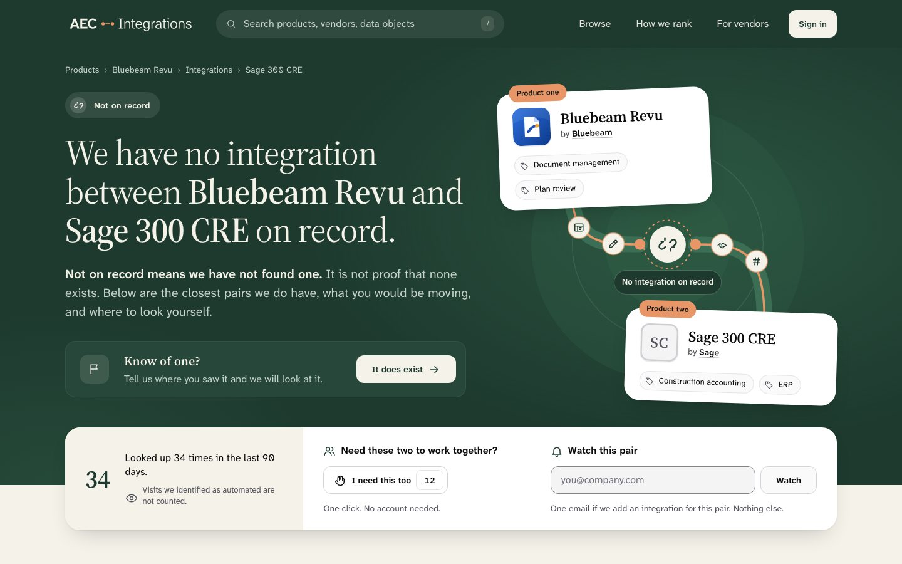

The work splits into six workstreams. Section 12 breaks them into issues.

| # | Workstream | Size | Blocked by |
| --- | --- | --- | --- |
| A | Empty pair page on the current design. This is AECI-1571 re-scoped. | Small | The ordering ruling |
| B | Demand captures: "I need this too", "Watch this pair", the look-up count | Medium | Privacy Policy text, two rulings |
| C | Ordering, the ranking firewall test and the "How ranking works" page | Small | The ordering ruling |
| D | Design language: tokens, `DESIGN.md` rewrite, header, Browse menu, footer | Large | A site-wide go or no-go |
| E | Product details page redesign | Large | D, and the hero ruling |
| F | Legal text | Small | B |

The biggest open decisions:

- **The ordering rule.** The mock-ups rank by inputs a paid plan can change. That cannot ship. See section 7.
- **What replaces the hero ring on the product page.** Chris doubts the ring. See decision 1 in section 11.
- **Whether the redesign is site-wide**, and in what order pages move.
- **Whether the captures stay inside AECI-1571.** I recommend they do not.

## 3. How we got here

This log exists so nobody re-proposes something already rejected.

### 3.1 The starting point, 2026-11-02 and 2026-11-11

Chris filed AECI-1571 on 2026-11-02 while reviewing the home redesign, AECI-1554. The pair finder on the home page could lead to a pair with no integration, and the visitor got no help.

The issue named two cases:

1. Both products exist and no integration links them. The page renders 200 with `noindex`.
2. A slug does not resolve. The visitor gets the generic 404 page.

A code survey on 2026-11-11 found three errors in the issue text.

| The issue says | What the code shows |
| --- | --- |
| The page gives "no explanation" | It already says "We don’t have any integrations documented between these two products yet." The gap is recovery, not the statement. |
| Use the "same tile as the home recent feed" | That tile was deleted in the home redesign, commit `9434b5bb8`. |
| Open "the existing feedback dialog pre-filled with the two names" | The home feedback form has no pre-fill. The request dialog does. |

The survey also found that `docs/STAGE_1_5_SPEC.md` §11.3 to §11.5 already specify a suggestions module, a "meaningful no" page and a per-pair report button. None is built. The issue does not cite them.

### 3.2 Possibilities and wireframes, 2026-11-11

Twelve ideas were listed. Three wireframes followed: a route finder, a closest matches page and an "open question" status page. A merged wireframe came next. Chris ruled as follows.

| Ruling | Detail |
| --- | --- |
| Only data we already hold | Everything shown must come from data we can already look up. |
| No bridges | No two-step routes through a third product. His words: "Saying you have to implement an ERP is just crazy talk." This also removed connector platform modules. |
| Keep "Watch this pair" and "I need this too" | He liked both, with the count shown on "I need this too". |
| One lane with a toggle | Closest matches is one list with a "Keep A / Keep B" button group, not two side-by-side lanes. |
| Category anchors | The visitor can switch which categories define "similar". |
| Cards are the default view | A table is the alternative. |
| Hide empty review rows | In the product facts table, when neither product has reviews, the reviews row and both rating rows are not shown. |
| Weekly bar chart deferred | Filed as AECI-1679. |
| Rejected: "Where people went next" | Dropped. |
| Rejected: workaround notes from users | Dropped. |

Dropped for failing the data rule: a last-checked date for the pair, a list of sources checked, a record id, a report count, a vendor statement and a record history. We store none of them for a pair.

### 3.3 Mock-up rounds, 2026-11-11 and 2026-11-12

Chris asked for real mock-ups with full creative ownership, not tied to the current site.

| Round | Mock-ups | Outcome |
| --- | --- | --- |
| 1 | "Public record", "Drawing sheet", "Workbench" | Rejected. "Those are still wireframes." He disliked the fonts and the colours. He asked for the AECi fonts. |
| 2 | 4 "Interaction first", 5 "Statement first" | 5 won. "I REALLY like 5." |

Mock-ups 1 to 4 and all wireframes were exploration. They were not kept in this folder.

Each round-2 mock-up carried three colour schemes. Only the AECi brand scheme is decided. The other two, "Harbour" and "Chalk and cobalt", remain in the files as comparison options. The design review found that Harbour resembles Procore's navy and orange, which `PRODUCT.md` names as an anti-reference.

### 3.4 The product page, 2026-11-12

Chris asked for a product details page in the same style. Mock-up 6 covers Bluebeam Revu with 14 integrations. He then asked how two cases would look, and mock-ups 7 and 8 answer them: Procore with 58 integrations, and a product with none.

### 3.5 Design review and legal review, 2026-11-12

The mock-ups went through the `impeccable` design skill and an axe accessibility pass. Scores were 26 to 29 out of 40, the skill's "good" band. Section 10 lists the defects still open.

A separate legal agent reviewed the mock-ups. Its verdict was `decision`, for the ordering. Section 8 lists every item. The copy and icon fixes it asked for were applied to the mock-ups.

### 3.6 The ring and the ordering, 2026-11-13

Chris proposed ranking the hero ring by the number of data flows, with random order among ties. A code check found only a Managed vendor can change that number. Section 7 has the detail. Chris then asked whether the ring is the right thing at all. That question is open.

### 3.7 The Browse menu, 2026-11-13

| Step | What changed |
| --- | --- |
| 1 | Chris asked for a "Categories" dropdown like a reference mega-menu from Hers. |
| 2 | He replaced invented category groups with four columns: Categories, Phases, Audiences, Trades. Each shows the top items by product count, except Phases, which run in project order. Each ends with a "See all" link. |
| 3 | "Browse" and "Categories" merged into one header item, "Browse". |
| 4 | A first column gained "All products" and key categories. He asked that one be AI. |

### 3.8 The 45 clashes, 2026-11-13

An audit found 45 places where the new design breaks a written design rule. Chris marked a ruling on each in a Word document. Section 9 has the table. The rulings were applied to the mock-ups.

### 3.9 Two late fixes, 2026-11-13

- **Sticky bar branding.** When the product page scrolled, the sticky bar showed the product's logo and name in the top-left corner, with our header gone. Chris asked whether that made the page look like the vendor's own website. It did. The bar now leads with the AEC Integrations wordmark, and the product name follows as plain text with no logo.
- **Section nav.** Chris disliked the nav looking like a button group. It is now a plain nav bar with an underline on the current section.

## 4. The design language

Every value below was measured from the final mock-up files on 2026-11-13. The clash numbers say which ruling decided each part.

### 4.1 Colour

| Role | Token in the mock-ups | Value | Where it may be used |
| --- | --- | --- | --- |
| Forest | `--brand`, `--hero-bg` | `#1E3A2F` | Header, detail page hero, footer, primary buttons, pressed toggles |
| Forest hover | `--brand-hover`, `--hero-bg-2` | `#2E5C45` | Hover states, the soft glow in the hero |
| Forest soft | `--brand-soft`, `--band-cool` | `#ECF1EE` | Selected filter chips, icon tiles |
| Hero panel | `--hero-panel` | `#26473A` | Panels sitting on the Forest hero |
| Footer ground | `--foot-bg` | `#15291F` | Footer only |
| Bone | `--band-warm`, `--hero-ink`, `--cta-bg` | `#F5F2EA` | One tinted band per page, text on Forest, the main button on Forest |
| Clay | `--accent`, `--hero-accent` | `#E89668` | Strokes and accents only: the hero ribbon, the active nav bar |
| Clay deep | `--accent-text`, `--meter-b` | `#A14D22` | The onboarding series colour in rating displays |
| Ink | `--ink` | `#0A0A0A` | Body text |
| Ink secondary | `--ink-2` | `#52525B` | Secondary text |
| Ink tertiary | `--ink-3` | `#71717A` | Counts, quiet labels |
| Surfaces | `--surface`, `--surface-2`, `--surface-3` | `#FFFFFF`, `#FAFAFA`, `#F4F4F5` | Page, raised, sunken |
| Lines | `--line`, `--line-strong` | `#E4E4E7`, `#D4D4D8` | Separators |
| Field edge | `--field-edge` | `#84848D` | The border of every form control |
| Rating star | `--star` | `#DAA520` | Stars only |

Rules after the rulings:

- **Forest may fill the header, the hero of a detail page and the footer.** The reading area stays white. Clash 1.
- **One Bone band per page.** The alternating green bands were removed. Clash 2.
- **Clay never fills a button.** On Forest the main button is Bone with Forest text. Clash 3.
- **Clay does not carry text.** Product names highlighted in the hero are Bone. Clash 4.
- **Pressed toggles are solid Forest. Selected filter chips keep the soft wash.** Clash 5.
- **Every colour is a named token.** The build must convert them to OKLCH in `styles.css`, because the colour lint rejects loose values. Clash 6.

### 4.2 Type

The fonts are the current site's: Source Serif 4 for display and headings, Atkinson Hyperlegible Next for everything else. No monospace.

Chris asked to limit sizes and weights. The audit went from 36 distinct sizes to 10, and from 9 weights to 5.

| Token | Size | Family | Use |
| --- | --- | --- | --- |
| `--t-12` | 12px | Sans | Overlines, captions |
| `--t-13` | 13px | Sans | Chips, counts, small labels |
| `--t-14` | 14px | Sans | Buttons, secondary text |
| `--t-16` | 16px | Sans | Body, nav links |
| `--t-20` | 20px | Both | Lede text, card titles |
| `--t-24` | 24px | Serif | Sub-headings |
| `--t-36` | 28 to 36px, fluid | Serif | Section headings |
| `--t-fig` | 28 to 40px, fluid | Serif | Score and count figures |
| `--t-statement` | 34 to 56px, fluid | Serif | The pair page statement |
| `--t-display` | 40 to 72px, fluid | Serif | The product name |

- **Weights are 400 and 600.** Weight 500 survives on two chips that copy the live site.
- **Small section labels are uppercase overlines**: 12px, weight 600, letter spacing 0.08em. Clash 10 kept the current rule.
- **Display sizes are now allowed on detail pages.** Clash 7.
- **Stray sizes remain.** A measured pass still found 19px and 22px serif text and 12.5px sans text in mock-up 6. The build should snap them to the ramp.

Clashes 9 and 17 decided this section.

### 4.3 Spacing, radius and elevation

| Property | Decided values | Clash |
| --- | --- | --- |
| Spacing | The 4-point scale: 4, 8, 12, 16, 24, 32, 48, 64, 96px | 17 |
| Page width | 1328px wrap with 48px gutters | none |
| Control radius | 12px for buttons and inputs | 12, 20 |
| Card radius | 24px | 12 |
| Chips | Full pill | 12, 22 |
| Small marks | 8px | 12 |
| Card shadow | `0 1px 3px rgb(0 0 0 / .06), 0 16px 36px -16px rgb(0 0 0 / .24)` | 11 |
| Menu shadow | `0 8px 24px -4px rgb(0 0 0 / .12), 0 2px 8px -1px rgb(0 0 0 / .06)` | 11 |
| Buttons, chips, inputs | Borders, no shadow | 11 |

- **One card shadow, in pure black.** It is for top-level floating surfaces only: the facts card and entity cards.
- **Primary actions are never pills.** "Sign in" is a rounded rectangle.
- **The hero keeps a soft single-colour glow.** The frosted glass blur and the noise texture are gone. Clash 13, second ruling.
- **Cards may nest, and coloured side stripes are allowed.** Chris chose the new design on clashes 14 and 15.

### 4.4 Components

| Component | Decision | Clash |
| --- | --- | --- |
| Buttons | One height everywhere, 44px. 12px radius. 14px text at weight 600. Secondary buttons are bordered. No shadow. | 20 |
| Main action | One filled button per surface. Other links are calm. | 21 |
| Chips | One public pill chip with an optional icon, plus one dense in-row variant. | 22 |
| Inputs | The new look, with a visible edge at 3 to 1 contrast. Errors add a thicker edge, an icon and a message. | 23 |
| Cards | Elevated, 24px radius. Grids cap at three columns with a group header or a wider lead card. | 18 |
| Meters | One public bar meter: single Forest hue, no gradient, the number always printed. | 19 |
| Large figures | One large figure per band. | 8 |
| Zero | A large "0" is allowed with honest supporting text. | 25 |
| Icons | A custom icon set at 1.75 stroke. Arrows may mean "go here". | 33, 34 |
| Agreement states | Only "Confirmed by both companies" is green. A one-company confirmation looks neutral. | 41 |
| Maintenance chip | Exactly two labels, "Vendor maintained" and "AEC Integrations maintained". No company name, no icon. | 40 |
| Field captions | "Maintained by {Vendor} · updated {date}", always with the date, no icon. | 40 |
| "Claimed" | No public label says "Claimed". | 39 |
| Breadcrumb | The separator is ›. | 31 |
| Wordmark | The shipped wordmark. | 42 |

Two of these rulings cost the design something. Section 10.3 covers them.

### 4.5 Logos

- **A product's logo and brand colour appear only when its listing is claimed, or on that product's own page.** Everywhere else an unclaimed product shows a neutral tile with its initials. This is counsel's ruling 9 as the legal agent read it.
- **The initial tile must not look lesser.** It carries no label and no muted styling.
- **No vendor logo or vendor colour in the sticky bar**, on any listing.

### 4.6 Motion

| Rule | Value | Clash |
| --- | --- | --- |
| Durations | 120ms, 180ms and 280ms | 36 |
| Hero diagram | One entrance animation is kept | 36 |
| Removed | The endless pulse, per-card stagger and bounce | 36 |
| Hover and press | Cards may lift and buttons may press | 37 |
| Smooth scrolling | In-page section links only. Never a global setting. Off under reduced motion. | 38 |

Chris's note on clash 38: "Make sure we know how to adopt the old way if needed." The mock-ups have an on and off switch. The build must not touch the router's scroll restoration.

### 4.7 The header

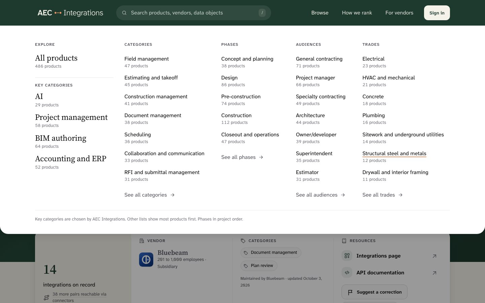

- **Links are Browse, How we rank and For vendors.** Products live under Browse as "All products". Clash 26.
- **The search control is a pill with a "/" shortcut hint.** Clash 29.
- **The active item has a Clay bar under it.** Clash 28.
- **The mobile toggle keeps the new look.** It must have a spoken name, and the open menu must trap focus and close on Escape. Clash 30.

### 4.8 The Browse menu

Structure:

| Column | Content | Order |
| --- | --- | --- |
| Explore | "All products" with the total count, then "Key categories" | Chosen by us |
| Categories | Top 7 categories, less any shown as a key category | Most products first |
| Phases | All 5 phases | Project order, from `taxonomy_phases.display_order` |
| Audiences | Top 7 | Most products first |
| Trades | Top 7 | Most products first |

- **Each facet column ends with its own "See all" link.**
- **Key categories default to four**: AI, Project management, BIM authoring, Accounting and ERP. Chris asked for AI. I picked the other three, and he has not confirmed them.
- **A footer line states the rule**: "Key categories are chosen by AEC Integrations. Other lists show most products first. Phases in project order."
- **No vendor or product names appear in the menu.** No "Popular", "New" or "Featured" badges.
- **The card is off by default.** A "How we rank" card existed in earlier versions. It does not fit beside five columns.

Behaviour contract:

- "Browse" is a real link to the all-products page. It also controls the panel, with `aria-expanded`, `aria-controls` and `aria-haspopup`.
- Hover opens it. The down arrow opens it and moves focus to the first link.
- Escape closes it and returns focus to "Browse". Mouse leave closes it after a short grace period.
- A press inside the panel must not close it before the click lands.
- The page behind is dimmed while it is open.
- On mobile the menu shows "All products" and the key categories first, then four tap-to-expand sections.

The real vocabularies, from the seed files:

| Vocabulary | Terms | Seed file |
| --- | --- | --- |
| Categories | 32 | `apps/api/seed/taxonomy.sql` |
| Audiences | 36 | `apps/api/seed/taxonomy.sql` |
| Phases | 5 | `apps/api/seed/taxonomy.sql` |
| Trades | 34 | `apps/api/seed/trades.sql` |

AI is a real category. Its seed description is "Products whose core function is machine learning or generative AI, rather than tools that merely include an AI feature."

Clash 27 decided that one mega-menu replaces the four dropdowns.

### 4.9 The sticky section nav

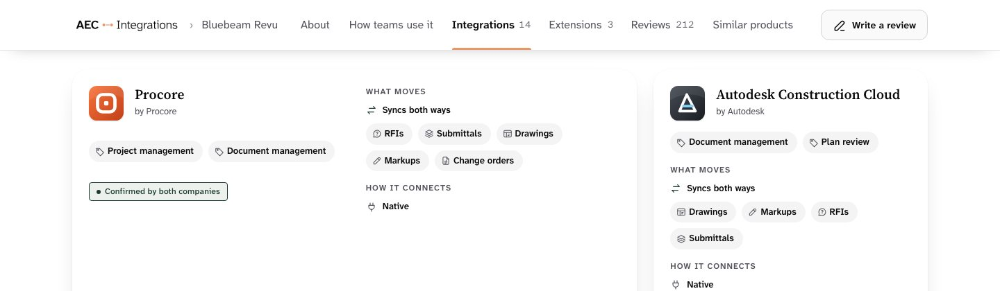

- **It reads "AEC Integrations › Bluebeam Revu".** Our wordmark holds the brand position.
- **Items are plain text links.** The current one is weight 600 with a 3px Clay bar on the bar's bottom edge.
- **Counts are quiet tabular numbers**, not badges.
- **The bar is a solid surface.** No blur.

### 4.10 The footer

The footer sits on a dark Forest ground. It keeps the four shipped columns, Directory, Help, Legal and Company, with overline labels. Clash 32.

## 5. Page specifications

### 5.1 The empty pair page

This is the page AECI-1571 is about. The sample pair is Bluebeam Revu and Sage 300 CRE.

**Purpose.** Tell the visitor honestly that we hold no integration, then give them somewhere useful to go.

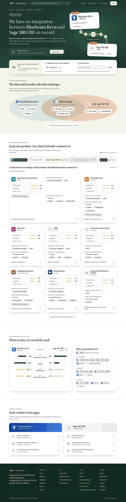

Sections in order:

| # | Section | Content | Data it reads |
| --- | --- | --- | --- |
| 1 | Hero statement | A "Not on record" pill and the statement | The pair has zero mechanisms |
| 2 | Hero visual | Two product cards with ribbons that stop at a "No integration on record" medallion | Name, vendor, logo, categories of each product |
| 3 | Correction entry | "Know of one?" with the button "It does exist" | Both product ids |
| 4 | Interest card | The look-up count, "I need this too", "Watch this pair" | Pair page views, plus two new captures |
| 5 | What you would be moving | Data objects in three groups: only A, both, only B | Data objects on each product's other integrations |
| 6 | Closest matches | One lane, a keep toggle, category anchors, cards or table | Each product's integrations and their partners |
| 7 | The two products, side by side | A facts table and "Who each product is for" | Counts, ratings, claim state, audiences, phases, trades |
| 8 | Look it up yourself | Each vendor's API docs and integrations directory links | `api_docs_url`, `tool_integrations_url` |

**Copy fixed by legal review or by ruling.** Use these strings exactly.

| Element | Exact copy |
| --- | --- |
| Status pill | Not on record |
| Statement | We have no integration between {A} and {B} on record. |
| Caveat | Not on record means we have not found one. It is not proof that none exists. |
| Correction heading | Know of one? |
| Correction body | Tell us where you saw it and we will look at it. |
| Correction button | It does exist |
| Look-up count | Looked up {n} times in the last 90 days. Visits we identified as automated are not counted. |
| Need button | I need this too |
| Need caption | One click. No account needed. |
| Watch heading | Watch this pair |
| Watch promise | One email if we add an integration for this pair. Nothing else. |
| Look it up intro | Linked as each vendor publishes them. What they say about building a connection is theirs, not ours. |

Never write that a product "does not integrate". The legal agent also asked that the caveat appear in the page title and description.

**Closest matches behaviour.**

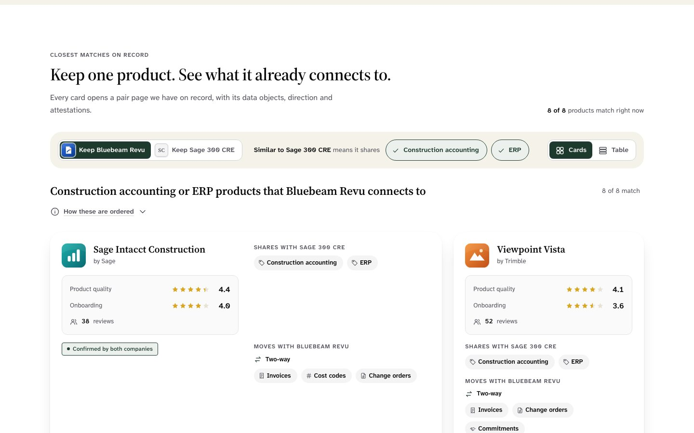

- A two-option button group: "Keep Bluebeam Revu" and "Keep Sage 300 CRE". One lane shows at a time.
- The lane heading restates the choice in plain words, such as "Construction accounting or ERP products that Bluebeam Revu connects to".
- The swapped product's categories appear as toggle chips. All are on by default. Turning one off narrows what "similar" means.
- Data object chips from section 5 also filter the lane.
- A live count shows, and each empty result has its own message.
- Each card shows the product, vendor, both ratings, review count, shared categories, the data objects moved, the direction, and the agreement state where there is one. It links to that pair page.
- Cards are the default. A table is the alternative.
- A "How these are ordered" disclosure is required. **Its current text describes an ordering that cannot ship.** See section 7.

**States.**

| State | Behaviour |
| --- | --- |
| Neither product has reviews | The reviews row and both rating rows are absent from the facts table. |
| Look-ups below the floor | The count is hidden and the other two controls fill the card. The proposed floor is 10. |
| No closest matches | A designed empty message. The page still shows sections 5, 7 and 8. |
| One product unclaimed | It shows an initial tile and no brand colour. |
| Correction style | Inline strip is the default. An "Is this right?" prompt is the alternative. Chris has not picked. |

**Rules that stay as they are today.**

- The page returns 200 with `noindex`. `docs/STAGE_1_5_SPEC.md` §7.3 and §11.1 item 4 both say so.
- JSON-LD rides the same decision. The resolver skips it on the same condition.
- No sitemap entry.
- A pair whose integration moved still redirects with a 301. That is AECI-953.

**The second case in AECI-1571 is unchanged by this plan.** A pair-finder pick whose slug does not resolve should land on `/search?q={typed name}`, not the generic 404. The issue also asks to confirm that the production search index and the database agree on slugs for the top 50 products. Neither was explored in the mock-ups. Both stay in the issue.

### 5.2 The product details page

The sample product is Bluebeam Revu.

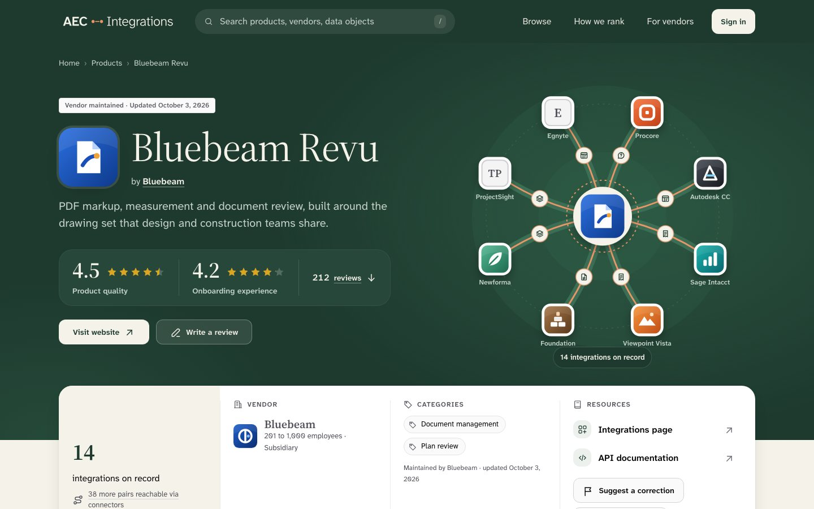

Sections in order:

| # | Section | Content | Data it reads |
| --- | --- | --- | --- |
| 1 | Hero | Maintenance chip, logo, name, vendor, one-line description, the two ratings with review count, "Visit website", "Write a review" | Product record |
| 2 | Hero visual | The product ringed by integration partners. **Open decision.** | Integrations |
| 3 | Facts card | Integration count with the connector reach line, vendor with size and ownership, categories, resources, correction and claim entries | Product detail payload |
| 4 | Section nav | About, How teams use it, Integrations, Extensions, Reviews, Similar products | Section presence |
| 5 | About | Description and "Who it is for": audiences, phases, trades | Product record |
| 6 | How teams use it | The vendor-authored narrative, by audience and by phase, with its source caption | The usefulness fields |
| 7 | Integrations | Filters, count, cards or table | `integrations_as_source` and `integrations_as_target` |
| 8 | Extensions | Tiles for products built within this one | `extensions` |
| 9 | Reviews | The two ratings kept apart, then review cards with vendor replies | Reviews |
| 10 | Similar products | Products sharing a category | `related_products` |

The agent that built it read the live product page for content only. It reported that every section the live page renders is present.

**Integrations section.**

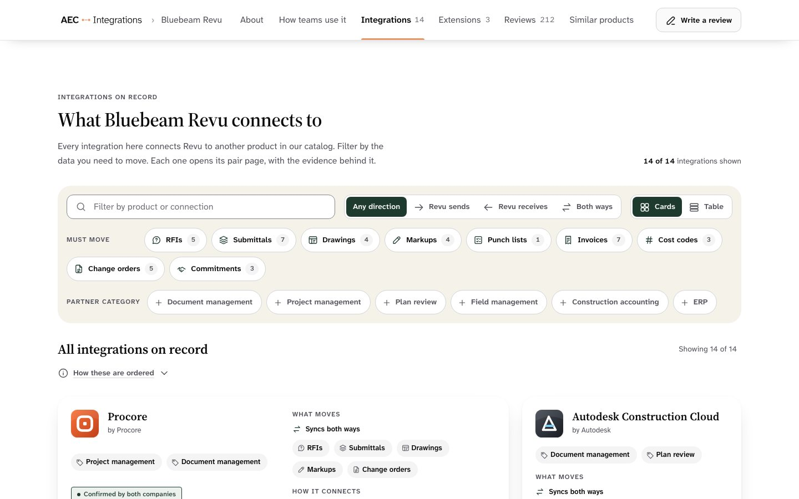

- Filters: a search box, direction, data objects, partner category.
- A live count, and cards by default with a table alternative.
- Each card shows the partner, its categories, what moves, how it connects, the agreement state and a link to the pair page.
- Clash 24 was ruled a blend. The build should use the shipped parts where they exist, and keep every row in the server-rendered HTML.

**Reviews section.**

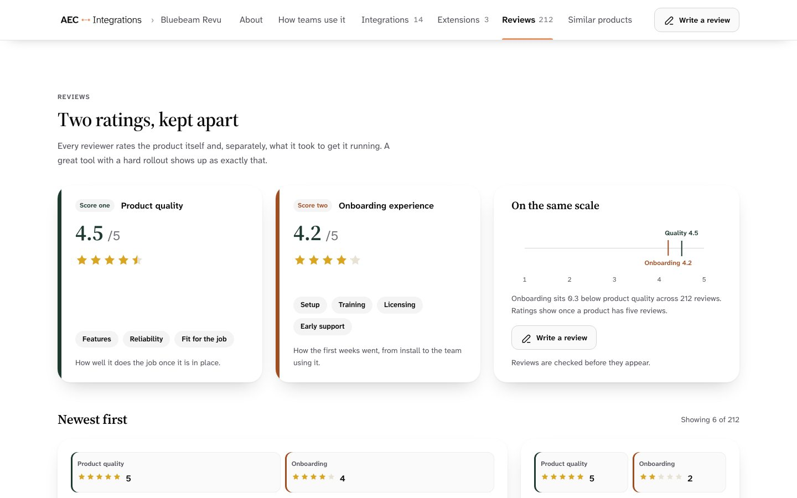

- Product quality and onboarding experience each get a card. A shared scale shows the gap between them.
- Ratings show once a product has five reviews. That matches the live rule.
- "Reviews are checked before they appear" matches the Review Guidelines.

**The 58-integration state.**

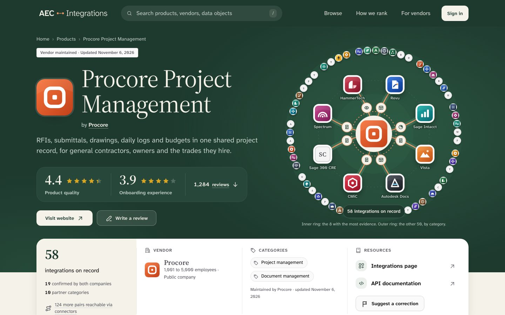

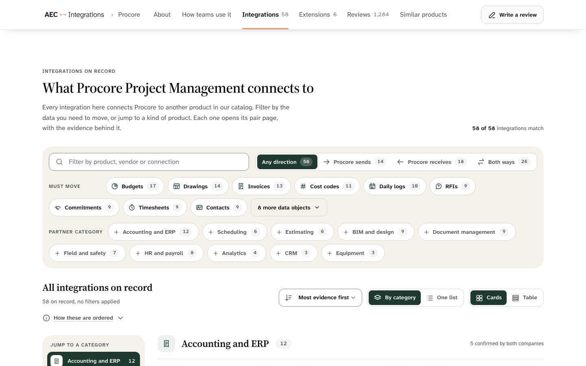

- The list groups by partner category, with a sticky jump rail and a "Show more" button per group.
- Every filter chip shows how many results it would leave.
- A "One list" mode loads 12 at a time.
- The hero shows an inner ring of 8 and an outer ring of the other 50. **Both the ring and its ordering are open.** See sections 7 and 11.
- The mock-up's default sort is "Most evidence first". **That cannot ship.** See section 7.

**The zero-integration state.**

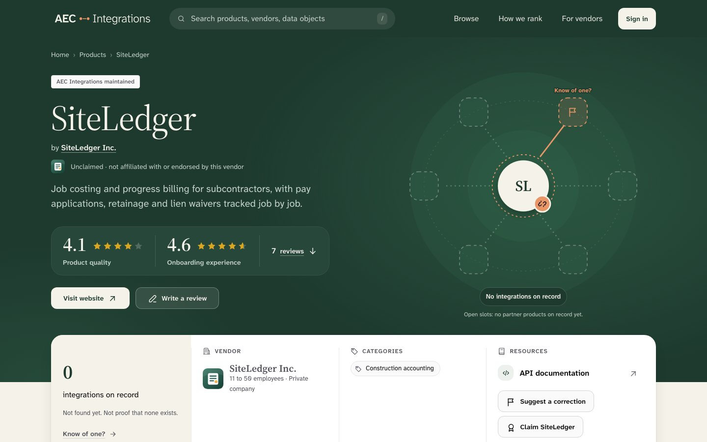

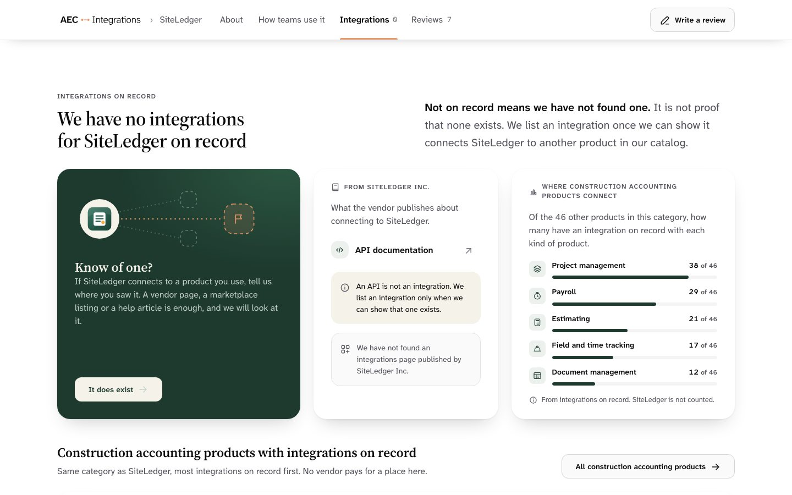

- The hero shows the product among empty slots, with one slot reading "Know of one?".
- The facts card shows "0 integrations on record" and "Not found yet. Not proof that none exists."
- The integrations section carries the same honesty rule and the "It does exist" button.
- Beside it: the vendor's own links, a chart of where products in the same category connect, and similar products that do have integrations.
- Extensions, the filters and the table view are absent. The section nav drops them.

Copy fixed by legal review for this state:

| Element | Exact copy |
| --- | --- |
| Heading | We have no integrations for {product} on record |
| Caveat | Not on record means we have not found one. It is not proof that none exists. |
| API note | An API is not an integration. We list an integration only when we can show that one exists. |
| No directory | We have not found an integrations page published by {vendor}. |
| Unclaimed note | Unclaimed · not affiliated with or endorsed by this vendor |

**Other states.** Unclaimed listing and "No reviews yet" are both in the mock-up's Options control.

**Not designed.** A connector product, which shows "Integrations it powers" and "Built within". Bluebeam Revu has neither, so mock-up 6 omits them.

## 6. Data and API work

Shared constraints for every row below:

- **Pages are edge cached for 15 minutes, keyed by URL.** The cache directive is `s-maxage=900` with `stale-while-revalidate=60`. The source is `docs/CACHE_STRATEGY.md`.
- **Cached HTML must be the same for every visitor.** A visitor's own "I need this too" click or watch state must be reconciled in the browser after hydration.
- **Every new write that changes domain state puts its `audit_log` row in the same `db.batch` as the write.**
- **Rate limits go on writes only**, registered per route after the guard. Reads are never rate limited.
- **Every string needs an i18n id.** No em dashes.
- **New endpoints need a Zod schema in `packages/shared/src/api/` and a row in `docs/API_CONTRACTS.md`.**

### 6.1 The empty pair page

The pair payload today carries, for each product: id, slug, name, logo, product role, vendor, integration count, review count, the two rating averages and claim status. It carries no categories, description, links or taxonomy. The type is in `packages/shared/src/api/product-pairs.ts`.

| Element | Data needed | In the pair payload today | Work |
| --- | --- | --- | --- |
| Statement, status | `mechanisms.length === 0` | Yes | None |
| Product cards | Categories of each product | Yes, since AECI-1822 | Delivered by AECI-1822 |
| Correction entry | Both product ids on a request | Partly. Requests have `context_product_id`. | See below |
| Look-up count | Pair page views, 90 days, automated visits removed | Views are recorded in `page_views` with pair columns. No public count exists. | New read, with a floor |
| "I need this too" | A de-duplicated per-pair count | No | New table, new write, repeat-click guard |
| "Watch this pair" | An email tied to a pair | No | New table, new write, new email |
| What you would be moving | Data objects on each product's other integrations | No. Data objects sit on claims per integration. | New derived read |
| Closest matches | The kept product's integrations, with each partner's categories, ratings and data objects | No | New read |
| Category anchors | The swapped product's categories | No | Comes with the row above |
| Facts table | Integration count, reviews, ratings, claim state | Yes | None |
| Who each is for | Audiences, phases, trades of both | Yes, since AECI-1822 | Delivered by AECI-1822 |
| Look it up yourself | `api_docs_url`, `tool_integrations_url` | Yes, since AECI-1822, `null` while AECi has a link hidden | Delivered by AECI-1822 |

**The correction entry needs a contract.** `docs/STAGE_1_5_SPEC.md` §11.5 requires the report to carry both product slugs "with distinguishable type/metadata so per-pair report counts are queryable". Today `RequestKindSchema` allows only `claim` and `correction`, and a request targets a product or a vendor. One context product id is not enough to identify a pair. The build must add a way to record both products, with its Zod schema, its API contract row and its audit row in the same batch. The request dialog can already pre-fill a body and a context product.

**The Listing Accuracy Policy sets response times for corrections.** A report through "It does exist" is a correction request. The policy promises to hide or flag a value within two business days of receiving a source. The build must not create a second, slower route.

### 6.2 The product details page

| Element | Data needed | In the product payload today | Work |
| --- | --- | --- | --- |
| Hero, facts card | Product record, ratings, vendor facts | Yes | None |
| Maintenance chip date | `products.last_reviewed_at` | The column exists in `apps/api/src/db/schema.ts` | Confirm it is in the payload. Not confirmed. |
| Connector reach line | `reachable_pair_count` | Yes | None |
| Integration cards | Partner, data objects, direction, connection kind | Yes | None |
| Partner category filter | Each partner's categories on the integration row | No | Add to the row |
| Agreement state on cards | The agreement state per integration | Not confirmed on this payload | Check, then add |
| Per-chip filter counts | Derived in the browser | Yes, from the rows | Browser only |
| Similar products | `related_products` | Yes, but the live page does not render it | Render it |
| Category chart on the empty page | Per category, how many products connect to each kind of product | No | New aggregate. Chris has not confirmed he wants it. |
| Review excerpts | Role and years of use | Yes | See below |
| Rating topic chips such as "Setup" and "Training" | Unknown | Not confirmed to exist | Treat as invented until checked |

**Reviews must not show company type.** The mock-up shows it. The live site shows role and years of use. The Privacy Policy says the firm "is not shown on your published review".

### 6.3 The Browse menu

| Element | Data needed | Exists today | Work |
| --- | --- | --- | --- |
| Product count per term | A count per category, audience, phase and trade | Not confirmed as one read | One cached read for the header |
| Total product count | One number | Not confirmed | Same read |
| Key categories | A short list chosen by us | No | A config list, not a table |

The header renders on every page. Its counts must come from a cached read and must purge when promote changes the catalog.

## 7. Ordering and the no pay-for-placement promise

This is the one part of the plan that can break a public promise.

### 7.1 The promise

- The Terms of Service say ranking is "never influenced by payment".
- `docs/STAGE_2_PAID_TIERS_SPEC.md` says entitlements gate "profile richness and portal capability only — never ranking, placement, or badge trust."
- The same spec says "No `listing_tier` input may need a plan to edit."
- Counsel's answer to question 23 says we must be able to prove the claim.

### 7.2 What the code check found

| Who | Can raise an integration's data flow count | Can lower it |
| --- | --- | --- |
| AECi, through promote | Yes | Yes |
| Managed vendor | Yes, by adding a data flow | Yes, by denying one or deleting one it added |
| Free vendor | No | No |

- Adding or voting on a data flow needs the `attestation.author` capability. The check is `requireAttestationCapability` in `apps/api/src/routes/vendor-attestations.ts`.
- Free holds four capabilities: `profile.edit`, `product.listing.edit`, `product.categories.edit` and `review.reply`. The list is in `packages/shared/src/entitlements.ts`.
- A vendor-added data flow shows publicly at once. Nothing reviews it first.
- A vendor cannot attach data objects when creating an integration.
- The public count is distinct data objects. One object moving both ways counts once.

So three things a Managed vendor can change are: whether an integration is "confirmed by both", how many data flows it has, and which data objects it lists.

### 7.3 What the mock-ups do, and why it cannot ship

| Place | Ordering in the mock-up | Problem |
| --- | --- | --- |
| Product page integrations, mock-ups 6 and 7 | "Most evidence first": confirmed by both, then most data objects, then name | Both inputs are Managed-only |
| Product hero ring, mock-up 7 | "The 8 with the most evidence" | Same |
| Pair page closest matches | Data objects in common with the visitor's picks, then shared categories, then product quality rating | The first input is Managed-influenced |
| Empty product page, similar products | Most integrations on record first | Creating an integration is open to any seat. It rewards volume. |

The disclosure text beside these says "Plan or license status has no effect on the order". With these orderings that sentence would be false.

The existing firewall tests would not catch it. They cover search attributes, sort keys and `listing_tier` inputs only.

### 7.4 What orders today

| Surface | Order today | Source |
| --- | --- | --- |
| Product page integrations | Partner name, then edge name, then id, sorted in the browser | `apps/web/src/app/products/connector-lane-grouping.ts` |
| Pair page mechanisms | Name, then id | `apps/api/src/routes/integrations.ts` |
| Related products | Newest first, limit 6 | `apps/api/src/routes/products.ts` |
| Search | `listing_tier`, then review count | `docs/SEARCH_RANKING.md` |

All four are clean. No plan can move them.

### 7.5 What Chris has and has not ruled

- **Ruled:** data-flow confirmation stays a Managed feature. This predates this work.
- **Proposed, not ruled:** rank the ring by number of data flows, with random order among ties. As stated it fails the firewall, for the reason in 7.2.
- **Then asked:** whether the ring is the right thing at all. Open.
- **Not ruled:** the order of the integrations list, of closest matches, or of similar products.

### 7.6 Options on the table

| # | Option | Effect |
| --- | --- | --- |
| 1 | A to Z everywhere, with visitor filters doing the narrowing | Matches today. Trivially provable. My recommendation. |
| 2 | Count only data flows AECi recorded, where `origin` is `aeci` | Keeps a meaningful rank that no plan can move. Vendor-added flows still show but do not count. |
| 3 | Let Free vendors add and confirm data flows | Makes Chris's proposal work as stated. Reverses his ruling that confirmation stays Managed. |
| 4 | Random order | Simple and fair. The order means nothing. |

If any option uses a random tie-break, the shuffle must run in the browser. A server shuffle would be frozen in the cache for 15 minutes. Search engines would see one fixed order, which should be A to Z.

### 7.7 Two further risks

- **The data object filter may hide Free vendors.** If only Managed vendors can add data objects, a "must move invoices" filter removes rows a Free vendor cannot fix. AECi seeds data objects for every integration through promote, so Free rows are not empty. How uneven the data is has not been measured.
- **"Confirmed by both companies" as a filter or a summary count.** A label on a row is profile richness, which a plan may buy. A filter or a sort on it is placement.

### 7.8 The binding rule for any build

Until Chris rules, every new list in this plan is ordered A to Z by name with the id as the tie-break, and the disclosure text says so. No build may ship the mock-ups' ordering or their disclosure wording.

Whatever rule he picks, the build must add a test beside the existing firewall tests. It must assert that no on-page sort, default order or featured subset reads an input gated by a capability outside the Free set.

## 8. Legal work

The legal agent's review of 2026-11-12 is in `records/legal-review-2026-11-12.md`. Its overall verdict was `decision`. It said nothing needs counsel.

### 8.1 Item by item

| # | Item | Verdict | Status |
| --- | --- | --- | --- |
| 1 | "No integration on record" with the caveat | none | Done in mock-ups. Still to do: the caveat in the page title and description. |
| 2 | "Know of one? It does exist" | none | Must open the existing correction request |
| 3 | "Watch this pair" | text | Privacy Policy first. Retention ruling needed. |
| 4 | "I need this too" | text | Privacy Policy first if the repeat-click flag lives in the browser |
| 5 | Look-up count | text | Reworded in mock-ups. Floor ruling needed. Privacy Policy line needed. |
| 6 | Closest matches | text | The ordering must be described on "How ranking works" |
| 7 | Ordering statements and the ring | decision | Open. See section 7. |
| 8 | Vendor labels and icons | none after change | Done in mock-ups |
| 9 | Unclaimed note | none | Exact string in mock-ups. The build should use the shared component. |
| 10 | "An API means a connection could be built" | none after change | Reworded in mock-ups |
| 11 | Category chart | none | No change needed |
| 12 | "Updated" and "Reviewed" dates | none, with a condition | "Reviewed" was removed from the mock-ups. The column exists, so it can return. |
| 13 | Names and logos | conflicts with ruling 9 | Initial tiles applied in mock-ups |
| 14 | Reviews | none, one check | Company type must go. Not yet fixed in mock-up 6. |
| 15 | Outbound vendor links | none | No change needed |
| 16 | Captions | change needed | Fixed in mock-ups |

### 8.2 A correction to the legal agent's wording

The legal agent suggested "Listing claimed by {vendor}" was acceptable wording with a pencil icon. A later check against `DESIGN.md`, the counsel record and the live pages found otherwise.

- No public page says "Claimed" today, and that wording is approved nowhere.
- "Maintained by {Vendor} · updated {date}" is approved for field captions only.
- The page-level chip keeps two fixed labels with no company name and no icon.

The mock-ups now follow this. Clashes 39 and 40 record it.

### 8.3 Legal text to write before a feature ships

| Document | Section | What to add | Needed by |
| --- | --- | --- | --- |
| Privacy Policy | What we collect | The watch-a-pair email and its one use | Watch |
| Privacy Policy | Retention | How long a watch address is kept | Watch |
| Privacy Policy | Cookies and similar technologies | The repeat-click flag, if it lives in the browser | I need this too |
| Privacy Policy | Our own visit count | That we publish aggregate look-up counts | Look-up count |
| "How ranking works" help page | New section | The order of a product's integrations and of closest matches, and that key categories in the menu are our pick | Any new list |

The Privacy Policy changes follow `docs/STAGE_1_SPEC.md` §27.2: a Legal issue, the text change, counsel review, and a version bump if the document is in force. Code and text merge together, or the code waits.

"One email. Nothing else" is a promise. A watch address must not join the mailing list.

### 8.4 Rulings still needed

| Ruling | Suggested answer | Source |
| --- | --- | --- |
| Retention for a watch address | Delete after the email is sent, or after 12 months | Legal agent |
| Floor for the look-up count | 10 | Legal agent |
| Brand colours for unclaimed products | None | Legal agent's own reading. The record is silent. |
| The large product logo and name in the product hero | Probably fine, because our header sits above it. Ask in the next legal check. | My reading, not the legal agent's |

### 8.5 The sticky bar finding

The first product page design put the product's logo and name in the top-left corner of a sticky bar, with our header scrolled away. That reads as the vendor's own website. On an unclaimed listing it contradicts "not affiliated with or endorsed by this vendor". The fix is in section 4.9. This reading is mine, not counsel's.

## 9. Changes to DESIGN.md and other docs

### 9.1 The 45 rulings

"New" means the new design wins and the rule is rewritten. "Current" means the current rule stands and the mock-up was changed. "Blend" means the stated mix.

**New design wins: 17 clashes. Each rewrites a rule.**

| # | Clash | Rule to rewrite |
| --- | --- | --- |
| 1 | Forest as the page ground | `DESIGN.md` §2, the Surfaces-Are-Neutral Rule. Also the `PRODUCT.md` position on a dark front door. |
| 7 | Display type on detail pages | `DESIGN.md` §3 Hierarchy |
| 14 | Cards inside cards | `DESIGN.md` §6, and the vendor reply placement rule |
| 15 | Side stripes | `DESIGN.md` §6 |
| 16 | The detail page layout | `DESIGN.md` DetailLayout |
| 23 | Inputs | `DESIGN.md` inputs. The 3 to 1 edge stays. |
| 25 | A bare zero | `DESIGN.md` IntegrationStat and the glance band |
| 26 | The header's main links | `DESIGN.md` primary row and the Overflow Rule |
| 27 | One mega-menu for four dropdowns | `DESIGN.md` dropdown behaviour rule |
| 28 | Active-state markers | `DESIGN.md` active route rule |
| 29 | Header search and sign-in | `DESIGN.md` header search rule |
| 30 | The mobile menu | `DESIGN.md` mobile rule. The label and focus trap stay. |
| 33 | Arrows used for navigation | `DESIGN.md` Arrow Rule |
| 34 | Icons and logo tiles | `DESIGN.md` §6, `PRODUCT.md`, `docs/BRAND_GUIDELINES.md` §7 |
| 35 | The hero diagram | New rule. None exists. |
| 37 | Hover and press movement | `DESIGN.md` buttons and cards |
| 38 | Smooth scrolling | Scoped to in-page links. `CLAUDE.md` scroll rule stays. |

**Current rule stands: 8 clashes. Each confirms a rule.**

| # | Clash | Rule confirmed |
| --- | --- | --- |
| 10 | Eyebrows and microheadings | Overline role, Sentence-Case Rule |
| 21 | Link styling | Link Treatment Rule |
| 31 | The breadcrumb separator | › |
| 39 | A public "claimed" label | No public label says Claimed |
| 40 | The maintenance chip and field captions | Two fixed labels, no icon |
| 41 | The agreement states | The four-state tonal ladder |
| 42 | The wordmark | The shipped wordmark |
| 44 | The anchor reference site | Record an anchor for every surface |

**Blend: 20 clashes.**

| # | Clash | The blend |
| --- | --- | --- |
| 2 | Tinted bands | White body. One Bone band per page. No green bands. |
| 3 | Clay fills buttons | On Forest, the main button is Bone with Forest text. Clay stays a stroke and accent. |
| 4 | Clay carries text | Clay deep stays as the onboarding series colour. Highlighted names are Bone on Forest. |
| 5 | Selected states | Solid Forest for pressed toggles. The wash for selected filter chips. |
| 6 | Loose colour values | New surfaces become OKLCH tokens in `styles.css`. The rest are dropped. |
| 8 | Large figures | One large figure per band. |
| 9 | The type ramp | The limited ramp in section 4.2. |
| 11 | Shadows | One card shadow for floating surfaces. Borders on controls. |
| 12 | Radii and pills | 24px cards, 12px controls, pill chips. No pill buttons. |
| 13 | Gradients, noise, glass | Keep the soft single-colour glow. No blur. No noise. Ruled on a second pass. |
| 17 | Spacing | Snap to the 4-point scale. Chris's note asked to limit type too. |
| 18 | Card grids | Three columns at most, broken by a group header or a wider lead card. |
| 19 | Charts and meters | One public bar meter, single Forest hue, number printed. |
| 20 | Buttons | One 44px height, 12px radius, bordered secondary, no shadow. Chris's note: same size buttons. |
| 22 | Chips | One pill chip and one dense variant. |
| 24 | The integrations section | Build from shipped parts. Keep rows in server HTML. Grouping goes through clash 45. |
| 32 | The footer | Forest ground. Four shipped columns and overline labels. |
| 36 | Animation | 120, 180 and 280ms. One hero entrance. |
| 43 | Public demand counts | Ship "Know of one?" first. Write a rule before any public count ships. |
| 45 | The same-behaviour rule | List each departure for Chris. Record what he keeps. |

The full record is in `records/design-rulings.md` and `records/design-clashes.md`.

### 9.2 Floors that hold whatever the ruling

- **Inputs:** a visible boundary at 3 to 1 on every form control. This is WCAG 1.4.11.
- **Mobile menu:** a spoken name on the toggle, and a focus trap.
- **Logos:** unclaimed products show initial tiles outside their own page.
- **Smooth scrolling:** never breaks router scroll restoration, and respects reduced motion.

### 9.3 Automated checks that will fail

| Check | Why it fails | Fix |
| --- | --- | --- |
| The colour guard in `pnpm lint` | Loose colour values and tinted shadows | Tokens in `styles.css`, shadows in pure black |
| `site-footer.component.spec.ts` | It pins the shipped footer columns | Keep the four columns, as clash 32 ruled |

The light-only guard does not fire. The design is light.

### 9.4 Departures to raise under the same-behaviour rule

Clash 45 requires these to go to Chris one by one before any build.

- Integration filters sit in their own panel, not in the shared facet panel.
- The 58-integration list groups by category with a jump rail.
- Paging is a "Show more" button per group plus a load bar.
- Empty states are illustrated.
- A sort control appears on the integrations list. The clash audit says Chris ruled against a sort control there before. Not confirmed.

### 9.5 Other docs that go stale

| Doc | What changes |
| --- | --- |
| `DESIGN.md` | Most sections, per 9.1 |
| `PRODUCT.md` | The position on brand colour as a ground, and on icons |
| `docs/BRAND_GUIDELINES.md` | Colour use, icons, a reversed wordmark |
| `docs/STAGE_1_5_SPEC.md` | §11.3 to §11.5: the page template, the no-bridge ruling, the new modules, the ordering rule |
| `docs/STAGE_1_SPEC.md` | §4.2 product page |
| `docs/API_CONTRACTS.md` | Every new or widened endpoint |
| `docs/DATABASE_SCHEMA.md` | The two capture tables, the pair on a request |
| `docs/CACHE_STRATEGY.md` | Tags for the new reads and the header counts |
| `docs/NOTIFICATIONS.md` | The watch email. It is generated from the registry, so the registry changes. |
| `docs/email.md` | The watch email template |
| `docs/ANALYTICS.md` | Events for the new controls, and the public use of view counts |
| `docs/STAGE_2_PAID_TIERS_SPEC.md` | The firewall section, for on-page ordering and the new test |
| `docs/TESTING_STRATEGY.md` | The new firewall test |
| The "How ranking works" help page | See 8.3 |
| The Privacy Policy | See 8.3 |
| `ANGULAR_STYLE_GUIDE.md` | The lint rule map, if the colour guard changes |

## 10. Known defects in the mock-ups

The mock-ups are a design reference. The build must not copy these. Chris put the design review findings on hold, so most are unfixed.

### 10.1 Contrast failures

Measured on 2026-11-12, before the rulings were applied. They need re-measuring.

| Element | Page | Measured | Needs |
| --- | --- | --- | --- |
| "Onboarding 4.2" label on the review scale | 6, 7, 8 | 3.78 to 1 | 4.5 to 1 |
| "Published by Sage" on the lookup card | 5 | 3.9 to 1, and 3.42 to 1 on mobile | 4.5 to 1 |
| The mark between the two products | 5 | 4.40 to 1 | 4.5 to 1 |
| Hero "reviews" link | 6, 7, 8 | 4.40 to 1 | 4.5 to 1 |
| Email placeholder | 5 | 4.4 to 1 | 4.5 to 1 |
| The Clay bar under the active section nav item | 6, 7, 8 | About 2.3 to 1 on white | Weight and text colour also mark it. A Forest bar would be stronger. |

### 10.2 Layout and behaviour

- The table view is clipped at 1440 pixels on mock-ups 5 and 6.
- The section nav clips between about 900 and 1300 pixels wide. It scrolls sideways.
- On mock-up 5, one to three results leave blank columns in the grid.
- On mock-up 7, category chips and the jump rail show different counts for the same category.
- No page has a skip link. Footer headings skip a level.
- The integration count appears four times on the product page.
- Mock-up 7 shows too many filter controls at once.
- On mock-up 5 the matches start far down the page.
- The sticky bar does not stick during a fast scripted scroll. The screenshots force the state.
- Each match card on some earlier variants was one long link. Check the card link names for screen readers.

### 10.3 Things the rulings made worse

| Clash | What happened | My recommendation |
| --- | --- | --- |
| 8 | Score figures dropped to 40px. The score cards look half empty. | Bring the figures back up |
| 9 | Section headings got smaller. The bands feel quieter. | Review after the type ramp is settled |
| 18 | The first card is wider than the rest and has slack space. | Drop the wide lead card |

Chris has not answered these.

### 10.4 Content that is wrong or invented

- Review excerpts in mock-up 6 show company type. See 6.2.
- Topic chips on the rating cards may not exist as data.
- The ordering copy and "Most evidence first" sort. See section 7.
- "Sage 300 CRE" appears in mock-up 7's ring as unclaimed and also "Confirmed by both companies". That is a sample data slip.
- All product logos are invented marks. The real pages use the logos we hold.
- Menu product counts are placeholders. AI shows 29, which is not a real count.

### 10.5 Missing assets

- **A reversed wordmark.** The shipped dark-background file has a solid green box behind the letters. The mock-ups recolour the letter shapes directly. A clean light-on-dark wordmark must be made through `branding/logo-construction.md`.

### 10.6 Checks that never ran

- No screen reader pass.
- No contrast audit after the rulings were applied.
- The `impeccable` in-browser overlay. The command-line detector ran in its place.

## 11. Open decisions

| # | Question | Options | My recommendation | Blocks |
| --- | --- | --- | --- | --- |
| 1 | What replaces the hero ring on the product page? | Keep the ring. A category hub with counts. A pair finder. A data flow map. A project phase strip. The two ratings. No visual. | A category hub with a pair finder under it. It features no product, so no ranking rule is needed. | Workstream E |
| 2 | What is the ordering rule for new lists? | The four options in 7.6 | A to Z everywhere | A, C, E |
| 3 | If a count is used, how is it made payment-proof? | AECi-recorded flows only. Open confirmation to Free. | AECi-recorded flows only | C |
| 4 | Does the Browse menu keep the "How we rank" card? | Off. A band under the columns. | Off | D |
| 5 | Which key categories sit beside AI, and how many? | 3, 4 or 5. Mine are Project management, BIM authoring, Accounting and ERP. | Four, after checking real counts | D |
| 6 | Do the score figures go back up, and does the wide lead card go? | Yes or no to each | Yes to both | E |
| 7 | Which correction entry style? | Inline strip. "Is this right?" prompt. | Inline strip | A |
| 8 | What is the look-up count floor? | 10, or another number | 10 | B |
| 9 | How long is a watch address kept? | Until the email is sent. 12 months. | Delete on send, or at 12 months, whichever is first | B, F |
| 10 | Do "I need this too" and "Watch" stay inside AECI-1571? | Inside. Separate issues. | Separate issues | A, B |
| 11 | Does "I need this too" show its count publicly? | Yes. Chris said he likes the count. | Yes, above the same floor as look-ups | B |
| 12 | Does the "Reviewed" date return on the maintenance chip? | Yes or no | Yes. The column exists. | E |
| 13 | Do review excerpts show role and years of use? | Yes. Keep company type. | Yes. Company type breaks the Privacy Policy. | E |
| 14 | What colour is the active bar in the section nav? | Clay to match the header. Forest for contrast. | Clay | D |
| 15 | Is the redesign site-wide, and in what order? | This page only. Product and pair pages. Everything. | Tokens and header first, then the pair and product pages, then the rest | D, E |
| 16 | Is the data object filter fair to Free vendors? | Ship it. Measure first. | Measure how uneven data objects are before shipping | A, E |
| 17 | How many products are in the AI category today? | Unknown | Check before making it a headline link | D |
| 18 | Who makes the reversed wordmark? | Unknown | File it with the design language work | D |
| 19 | Does the category chart on the empty product page stay? | Yes or no. It is a new aggregate. | Cut it for now | E |
| 20 | Does the 58-integration list group by category by default? | Grouped. One list. | Grouped, raised under the same-behaviour rule | E |
| 21 | Does trades, phases and audiences get the same key-item treatment as categories? | Yes or no | No | D |
| 22 | Does the pair page move its matches up under the hero? | Yes or no | Yes | A |

## 12. Proposed workstreams and issues

AECI-1571 as written is now much smaller than this plan. I recommend re-scoping it to workstream A and filing the rest separately. None of the issues below has been created in Linear.

Three issues may already cover part of this. `docs/STAGE_1_5_SPEC.md` names AECI-341 for the suggestions module, AECI-342 for the "meaningful no" page and AECI-343 for the per-pair report button. Their status was not checked. Check them before filing anything new.

Projects are my reading of the admission tests in `docs/ROADMAP.md`. Chris should confirm each.

### Workstream A: the empty pair page on the current design

This delivers the visitor value now, without waiting for the redesign.

| # | Issue | Scope | Project | Anchor | Legal impact | Blocked by |
| --- | --- | --- | --- | --- | --- | --- |
| A1 | AECI-1571, re-scoped | The honest statement and caveat. The correction entry opening the existing request flow. The two products side by side. "Look it up yourself". Built with current components. Still 200 and `noindex`. | Pilot | `docs/STAGE_1_5_SPEC.md` §11.4 | none, if no new capture and no new list | Nothing |
| A2 | Pair report carries both products | Record both product ids on a correction request so per-pair counts can be queried. Zod, contract row, audit in the same batch. | Pilot | `docs/STAGE_1_5_SPEC.md` §11.5 | none. It uses the existing correction path. | Check AECI-343 |
| A3 | Closest matches on the empty pair page | The keep toggle, category anchors, cards and table, A to Z order, the ordering disclosure. A new read. | SEO | `docs/STAGE_1_5_SPEC.md` §11.3 | text. "How ranking works" must describe the order. | Decision 2, C2, check AECI-341 |
| A4 | "What you would be moving" and the data object filter | The three groups and the filter on closest matches. | SEO | `docs/STAGE_1_5_SPEC.md` §11.4 | none | A3, decision 16 |
| A5 | Unresolved slug from the pair finder goes to search | The second case in AECI-1571, plus the production slug check for the top 50 products. | Pilot | `docs/STAGE_1_SPEC.md` §4.6 | none | Nothing |

### Workstream B: demand captures

| # | Issue | Scope | Project | Anchor | Legal impact | Blocked by |
| --- | --- | --- | --- | --- | --- | --- |
| B1 | "I need this too" | New table, one write, repeat-click guard, public count above a floor, browser reconcile after hydration. | SEO | `docs/STAGE_1_5_SPEC.md` §11.4 | text. Privacy Policy cookies section if a browser flag is used. | F1, decisions 10 and 11 |
| B2 | "Watch this pair" | New table, one write, one email on first integration, deletion per the retention ruling. Never joins the mailing list. | SEO | `docs/STAGE_1_5_SPEC.md` §11.4 | text. Privacy Policy, two sections. | F1, decision 9 |
| B3 | Public look-up count | A read over pair page views with automated visits removed, hidden below the floor. | SEO | `docs/ANALYTICS.md` | text. Privacy Policy visit count section. | F1, decision 8 |
| B4 | AECI-1679, weekly interest chart | Already filed. | Pilot today | `docs/STAGE_1_5_SPEC.md` §11.4 | none | B3 |

I placed B under SEO because these signals feed the §11.4 demand scoring. Platform is the alternative.

### Workstream C: ordering and the firewall

| # | Issue | Scope | Project | Anchor | Legal impact | Blocked by |
| --- | --- | --- | --- | --- | --- | --- |
| C1 | Firewall test for on-page ordering | A test that fails if any on-page sort, default order or featured subset reads an input outside the Free capability set. | Platform | `docs/STAGE_2_PAID_TIERS_SPEC.md` §3.2 | none | Decision 2 |
| C2 | "How ranking works": on-page lists | Add the order of a product's integrations, of closest matches, and the key categories pick. | Platform | The help page itself | text | Decision 2 |
| C3 | Measure data object coverage by plan | A one-off read: how many data objects Free and Managed vendors' integrations carry. | Platform | `docs/STAGE_2_PAID_TIERS_SPEC.md` §3.2 | none | Nothing |

### Workstream D: the design language

| # | Issue | Scope | Project | Anchor | Legal impact | Blocked by |
| --- | --- | --- | --- | --- | --- | --- |
| D1 | Rewrite `DESIGN.md` from the 45 rulings | The doc change only. Record this folder as the anchor. Update `PRODUCT.md` and the brand guidelines. | Platform | `DESIGN.md` | none | Decision 15 |
| D2 | Tokens and the type ramp | New tokens in `styles.css` as OKLCH, the limited ramp, radii, the card shadow. Update the colour guard if needed. | Platform | `DESIGN.md` | none | D1 |
| D3 | Core components | Buttons at one height, the pill chip, inputs, cards. | Platform | `DESIGN.md` | none | D2 |
| D4 | Reversed wordmark asset | A clean light-on-dark wordmark. | Platform | `branding/logo-construction.md` | none | Nothing |
| D5 | Header on Forest and the Browse menu | The merged menu, its counts read, key categories config, mobile menu with focus trap. | Platform | `DESIGN.md` navigation | text, for the key categories line on "How ranking works" | D3, D4, decisions 4, 5, 17 |
| D6 | Footer on Forest | Ground and colours only. Columns unchanged. | Platform | `DESIGN.md` footer | none | D2 |

Workstream D is Platform by the admission test, because it has no date. A pilot vendor would notice a new header. If Chris gives it a date it moves to Pilot.

### Workstream E: the product details page

| # | Issue | Scope | Project | Anchor | Legal impact | Blocked by |
| --- | --- | --- | --- | --- | --- | --- |
| E1 | Product page layout and hero | Bands, the facts card, the hero without the ring content. | Platform | `docs/STAGE_1_SPEC.md` §4.2 | none | D3, decision 1 |
| E2 | Sticky section nav | Our wordmark first, product as plain text, nav bar style. | Platform | `DESIGN.md` section nav | none | E1 |
| E3 | Integrations section | Filters, cards and table, A to Z, partner categories on the row, grouped mode for long lists. | Platform | `docs/STAGE_1_5_SPEC.md` §13.3 | text, if the order is described anew | E1, decisions 2 and 20, the same-behaviour rulings |
| E4 | Reviews section | Two rating cards and the shared scale. Role and years of use on excerpts. | Platform | `docs/STAGE_1_SPEC.md` §4.2 | none | E1, decision 13 |
| E5 | Zero-integration state | The honest empty section and the correction entry. | Platform | `docs/STAGE_1_5_SPEC.md` §11.4 | none | E3 |
| E6 | Similar products | Render `related_products`, ordered A to Z or as ruled. | Platform | `docs/STAGE_1_SPEC.md` §4.2 | none | E1, decision 2 |
| E7 | Hero visual | Whatever decision 1 picks. | Platform | New `DESIGN.md` rule | Depends on the pick | Decision 1 |
| E8 | Empty pair page in the new language | Restyle workstream A's page. | Platform | `docs/STAGE_1_5_SPEC.md` §11.4 | none | D3, A1 to A4 |

### Workstream F: legal text

| # | Issue | Scope | Project | Anchor | Legal impact | Blocked by |
| --- | --- | --- | --- | --- | --- | --- |
| F1 | Privacy Policy: pair captures and public counts | The four lines in 8.3. Counsel review. Version bump if in force. | Legal | `docs/STAGE_1_SPEC.md` §27.2 | text | Decisions 8 and 9 |
| F2 | Ask legal about the product hero | Whether a large product logo and name under our header needs care. | Legal | `docs/LEGAL_IMPACT_REVIEW.md` | none | Nothing |

### Recommended order

1. A1, A2 and A5. They need no ruling and close most of AECI-1571.
2. C3, then Chris rules on decision 2.
3. C1 and C2, then A3 and A4.
4. F1, then B1 to B3.
5. D1 to D6 if the redesign goes ahead.
6. E1 to E8.

## 13. Risks

| Risk | Why it matters | Mitigation |
| --- | --- | --- |
| An ordering ships that a paid plan can move | It breaks the Terms and the core positioning | The rule in 7.8 and the test in C1 |
| The redesign is adopted page by page and the site looks like two products | The Anchor-Site Rule exists to stop this | Do tokens, header and footer first |
| Thin "no" pages get indexed | A site-wide helpful-content penalty | The pages stay `noindex`. Nothing here changes that. |
| A public count is gamed or reveals one visitor | Trust, and privacy | The floor, the repeat-click guard, automated visits removed |
| Production page views are mostly automated | A raw count would be wrong | Use the existing human-traffic classification, and say "visits we identified as automated" |
| Visitor state leaks into cached HTML | A cache bug shown to every visitor | Reconcile after hydration. Strip visitor cookies before SSR. |
| The mock-ups are copied literally | They carry the defects in section 10 | Section 10, and this sentence |
| Vendor logos imply affiliation | Legal exposure, worst on unclaimed listings | The logo rule in 4.5 and the sticky bar rule in 4.9 |
| Forest on Clay or Bone pairs fail contrast | Accessibility is a hard rule | Re-run axe after tokens land |
| The header's menu counts slow every page | The header renders everywhere | One cached read, purged on promote |
| Data objects are uneven between plans | A filter becomes placement | C3 measures it first |
| This plan goes stale | Docs here are stale in known places | Check the code before trusting any fact above |

## 14. Artifact index

Everything is in `docs/design/mockups/redesign-2026-11/`.

### 14.1 Files

| Path | What it is |
| --- | --- |
| `PLAN.md` | This document |
| `README.md` | A short pointer, in the folder convention |
| `mockups/5-statement-first.html` | The empty pair page |
| `mockups/6-product-detail.html` | The product page, Bluebeam Revu, 14 integrations |
| `mockups/7-product-many.html` | The product page, Procore, 58 integrations |
| `mockups/8-product-none.html` | The product page, SiteLedger, none, unclaimed |
| `mockups/src/` | Build sources for mock-ups 7 and 8, the Browse menu and the rulings layer |
| `screens/` | Screenshots, shot from the final files on 2026-11-13 |
| `records/design-clashes.md` | The 45 clashes in full, with rule quotes |
| `records/design-rulings.md` | Chris's ruling on each |
| `records/AECi-design-clashes-RULED-2026-11-13.docx` | The Word document Chris filled in, with side-by-side images |
| `records/legal-review-2026-11-12.md` | The legal agent's review, as received |
| `records/impeccable-critique-pair-page.md` | Design review of mock-up 5 |
| `records/impeccable-critique-product-pages.md` | Design review of mock-ups 6, 7 and 8 |

Screenshots in `screens/` that are not embedded above:

| File | What it shows |
| --- | --- |
| `pair-moving.jpg` | The interest card and the top of "What you would be moving" |
| `pair-mobile.jpg` | The pair page at 390 pixels, full length |
| `product-full.jpg` | The product page at 1440 pixels, full length |
| `product-mobile.jpg` | The product page at 390 pixels, full length |
| `none-full.jpg` | The zero-integration product page, full length |
| `browse-menu-mobile.jpg` | The Browse menu at 390 pixels |

The ruled Word document uses the older labels. "Override" means the new design wins. "Adopt" means the current rule wins. "Combine" means blend.

The two design reviews were written before the legal fixes and the rulings were applied. They describe an earlier state of the mock-ups.

### 14.2 Opening the mock-ups

Open any HTML file in a browser. They need a network connection once, for the two fonts. They make no other request.

```bash
open docs/design/mockups/redesign-2026-11/mockups/6-product-detail.html
```

### 14.3 The Options control

Each page has a small "Options" control. **The default of each control is the decision. The alternates are not decisions.**

| Control | Default | Alternates | Pages |
| --- | --- | --- | --- |
| Palette | AECi brand | Harbour. Chalk and cobalt. | All |
| Simulate neither product has reviews | Off | On | 5 |
| Look-ups below the floor of 10 | Off | On | 5 |
| Correction style | Inline | "Is this right?" prompt | 5 |
| Unclaimed listing | Off | On | 6 |
| No reviews yet | Off | On | 6 |
| Compact data objects on cards | Off | Icons only | 6, 7 |
| Hero hub | Ring of 8 plus an outer orbit | Grouped by partner category. Ring of 8 only. | 7 |
| Integrations list | Grouped by category with a jump rail | One list, 12 at a time | 7 |
| Hero | Open slots, unlabelled | Slots labelled with category hints | 8 |
| Sticky bar brand | AECi wordmark | Product logo, the first design | 6, 7, 8 |
| Section nav | Nav bar | Button group, the first design | 6, 7, 8 |
| Browse menu: open | Off | On. Pins the menu for review. | All |
| Key categories | 4 | 3 or 5 | All |
| Menu items per column | 7 | 5 or 9 | All |
| Menu card | Off | On | All |
| Type and spacing | Limited | As first designed | All |
| Buttons | One size | As first designed | All |
| Hero and bars | Ruled: glow, no blur, no noise | As first designed. Fully solid. | All |
| Smooth scrolling | On | Off | All |

Two defaults are not decisions, because Chris has not ruled: the hero hub on mock-up 7, and the "Most evidence first" sort.

### 14.4 Rebuilding mock-ups 7 and 8

Mock-ups 5 and 6 are edited directly. Mock-ups 7 and 8 are assembled from mock-up 6's head and styles plus their own files in `mockups/src/`.

```bash
python3 docs/design/mockups/redesign-2026-11/mockups/src/build.py
```

| Script | What it does |
| --- | --- |
| `build.py` | Writes mock-ups 7 and 8 from mock-up 6 and the `7.*` and `8.*` sources |
| `catmenu.py` | Inserts the Browse menu into mock-ups 5 and 6 and into the two body sources, then rebuilds |
| `rulings.py` | Inserts the rulings layer and its Options controls |

The test and screenshot scripts were not kept. They depended on Playwright resolved from `apps/web` and lived in the workspace's ignored folder.

## 15. Plan check

Chris requires the `spec-anchor` plan check on any AECI plan before code. It was run on 2026-11-13 against the pair page part of this plan.

```
## Spec Review — AECI-1571

**Plan:** empty pair page: honest statement, correction entry, closest matches, data object filter, demand captures
**Spec anchor:** §4.4 (docs/STAGE_1_SPEC.md) → superseded; re-anchored to docs/STAGE_1_5_SPEC.md §7.3 and §11.3 to §11.5
**Reviewed against:** STAGE_1_5_SPEC.md §7.3, §11.1, §11.3, §11.4, §11.5; STAGE_2_PAID_TIERS_SPEC.md §3.2; LEGAL_IMPACT_REVIEW.md §2 and §3; CLAUDE.md constraints
**Doc updates the plan already carries:** section 9.5 of this plan
**Legal impact:** decision — the mock-ups' ordering reads inputs gated by a Managed-only capability, against the Terms of Service ranking promise; the smallest version needing no legal text is workstream A1 with A to Z order and no captures

🔴 CRITICAL
- `P5.1` — "Data objects in common with your picks come first" — ranking would depend on a paid tier. Data flows and confirmations need `attestation.author`, which only the `verified` tier holds. (STAGE_2_PAID_TIERS_SPEC.md §3.2; packages/shared/src/entitlements.ts:113; apps/api/src/routes/vendor-attestations.ts:231)

🟡 MAJOR
- `P5.1` — "It does exist" opens the existing correction request — §11.5 requires both product slugs "with distinguishable type/metadata so per-pair report counts are queryable", and a request carries one context product and two kinds only. (STAGE_1_5_SPEC.md §11.5; packages/shared/src/api/requests.ts:46; apps/api/src/db/schema.ts:1550)
- `P3.2` — "No two-step routes through a third product" — §11.4's template names a "data-object bridge" and the plan removes bridge claims and adds three modules §11 does not have, so §11.3 to §11.5 need an update step, with API_CONTRACTS.md, DATABASE_SCHEMA.md, CACHE_STRATEGY.md and the how-ranking-works page. (STAGE_1_5_SPEC.md §11.4; apps/web/src/app/products/products-pair.ts:1301, the empty branch this plan replaces)

🔵 MINOR
- `P0` — the issue anchors to STAGE_1_SPEC.md §4.4, which is superseded by Stage 1.5. (STAGE_1_SPEC.md:336)
- `P0` — the issue's "same tile as the home recent feed" names a component deleted in commit 9434b5bb8, and its "feedback dialog pre-filled" has no pre-fill input. The plan follows the code.
- `P0` — the issue's line reads "Legal impact: none." which fails the required format and is now the wrong verdict.
- `P12` — AECI-341, AECI-342 and AECI-343 already own §11.3 to §11.5. Their status was not checked.

❌ Revise the plan before implementing — 1 critical, 2 major.
```

How each finding was folded in:

| Finding | Where it is folded in |
| --- | --- |
| Critical: ordering depends on a paid tier | Section 7.8 makes A to Z binding until Chris rules, bans the mock-ups' ordering and disclosure text, and requires a new firewall test. Issue C1 carries the test. Decision 2 carries the ruling. |
| Major: the report needs both products | Section 6.1 states the contract gap. Issue A2 carries it. |
| Major: the spec needs updating | Section 9.5 lists the spec and companion docs. Each issue in section 12 updates its own docs in the same PR. |
| Minor: superseded anchor | The plan anchors to Stage 1.5. The issue's line should be corrected when it is re-scoped. |
| Minor: errors in the issue text | Recorded in 3.1. |
| Minor: the issue's legal line | Workstream A1 states its own verdict. The issue needs the corrected line. |
| Minor: overlapping issues | Section 12 says to check them before filing. |

The anchor resolved. `### 4.4 Integration page` exists in `docs/STAGE_1_SPEC.md`, and it carries a banner pointing to Stage 1.5. All required CI lanes run on pull requests into `main` with no base-branch filter.

The plan check covered the pair page only. The product page, the design language and the Browse menu have not had a plan check. Each needs one when its issue is planned.

## 16. Summary

- **Legal impact is `decision`.** Rule on the ordering before any list in this plan is built. I recommend A to Z everywhere.
- Re-scope AECI-1571 to the honest empty state, the correction entry and the slug fix, on the current design.
- Check AECI-341, AECI-342 and AECI-343 before filing any new issue.
- Decide whether the redesign goes site-wide. Workstreams D and E wait on that.
- Decide what replaces the hero ring. I recommend a category hub with a pair finder.
- Rule on the watch address retention and the look-up floor, so the Privacy Policy text can be written.
- Do not copy the mock-ups literally. Section 10 lists their defects.
- Keep this folder. It is the only durable record of the mock-ups and the 45 rulings.
